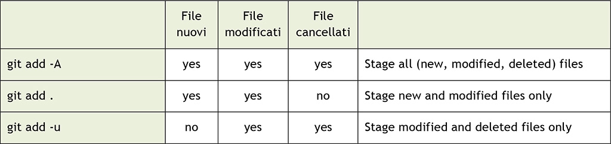
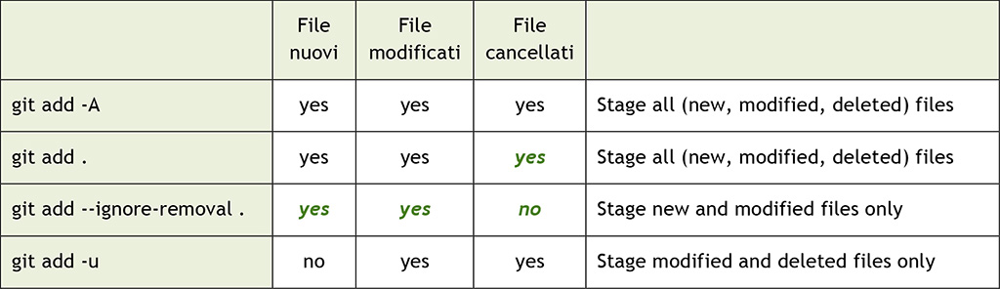

*Part ten of the series, first published on [MokaByte](https://mokabyte.it/2018/01/14/git-10/) on 14 January 2018. The text stays as I wrote it then, with a note at the end about what changed.*

## Introduction: managing files on three levels

New year, new article, which by the way is the tenth of this long series about the principles and use of Git.

In this instalment we will start analysing the system Git uses to **manage** **files**. To keep track of the current work, of the files we will put into the next commit and of those already in a repository, Git in fact uses three "areas", that is, three distinct levels where differences can exist. Today we will try to understand how to move between these areas, a skill you must acquire to use this version control tool correctly.

In this article we will start with a series of practical "experiments" to run at the console, so you get immediate feedback on what happens in practice. In the next issue, instead, we will try to summarise what we learned today by illustrating the "theory" of the three areas and looking further into some commands.

## Staging area, working tree and HEAD commit

In previous instalments we mentioned the **staging area**, also called **index**, several times, especially when it came to adding files to the next commit with the **git** **add** command.

To this we add the **working tree** and the **HEAD commit**, which we will start to see in these pages.

### Staging area

The purpose of the **staging** **area** is precisely what we have already seen. When we change the content of a file, add a new one or delete an existing one, we need to tell Git which of these changes will be part of the next commit we are going to package: the **staging** **area** is exactly the container for this kind of information.

For now let us focus on this; let us move to the **master** branch of our usual repository and type the **git** **status** command; this command lets us see the current state:

```
[1] ~
$ cd es03
```

```
[2] ~/es03 (bevande)
$ git checkout master
Switched to branch 'master'
```

```
[3] ~/es03 (master)
$ git status
On branch master
nothing to commit, working tree clean
```

Git says there is nothing to commit, our **working tree** is clean.

### Working tree

But what is a **working tree**? Is it the same working directory we talked about before, calling it **working copy** or **working directory**? The answer is "yes and no"; and this is a bit confusing, I know.

Git had, and still has, some **trouble** with **names**; in fact, as we said above, even for the **staging** **area** we have two names: the other is **index**. Git uses both names in its messages and in command output, and so do people, books and blogs like this one. Having two names is not always a good idea, especially when they represent exactly the same thing; for now the only solution is to be aware of it: time will give us a less confusing Git, I am sure.

Going back instead to **working** **tree** and **working** **copy**, the story is this. At a certain point, someone argued:

> If I am at the root of the repository, I am in a working directory, but if I move into a subfolder, I am in another working directory.

And indeed this is technically true from a **filesystem** point of view; in Git, however, operations like **checkout** or **reset** do not affect the current working directory, but the whole… **working** **tree**, the whole tree that makes up our repository.

In substance, talking about "working directory" in Git can be improper, because, unlike Subversion for example, which lets you check out only parts of the repository, that is, only some folders, in Git you always have the whole repository locally, the whole **working** **tree**.

So, to avoid confusion, Git stopped talking about the working directory in the git status output and "renamed" it **working tree**. Anyone who wants to go a little deeper can look for the commit that made this change in Git's history, and find the definition in the [glossary](https://git-scm.com/docs/gitglossary#Documentation/gitglossary.txt-aacdefworkingtree).

Despite the brevity and shallowness of the explanation, I hope I have clarified at least a little why there are two names.

### "Staged" files

Let us now run a small experiment and add a highlighter to our stationery list:

```
[4] ~/es03 (master)
$ echo "evidenziatore" >> cancelleria.txt
```

Now let us use this command we have just learned again, **git status**:

```
[5] ~/es03 (master)
$ git status
On branch master
Changes not staged for commit:
  (use "git add <file>..." to update what will be committed)
  (use "git checkout -- <file>..." to discard changes in working directory)
    modified: cancelleria.txt
no changes added to commit (use "git add" and/or "git commit -a")
```

OK, let us read the message; at some point it says "Changes not staged for commit": now is the time to review the meaning of **staged**; with the word **staged**, Git means the changes added to the **staging** **area**, those that will therefore be part of the next **commit**. In the current situation, we modified the **cancelleria.txt** file, but we have **not** added it to the **staging** **area** yet, using the good old **git** **add** command.

Because of this, Git informs us: it says there is a **modified** **file** (highlighting it in red), and then offers two options: one to **stage** the file, and therefore add it to the **staging** **area**, through **git add <file>**, and one to discard the change, using the **git checkout -- <file>** command.

For now let us try adding it to the staging area; we will see the second option later. By the way, this is also a chance to learn a further aspect of command syntax. Let us try typing just the **git add** command, without arguments:

```
[6] ~/es03 (master)
$ git add
Nothing specified, nothing added.
Maybe you wanted to say 'git add .'?
```

OK: **git add** wants something to be **specified**, otherwise it does not know what to do. A common behaviour is to use the **dot** (sign **.**), which by default means "Add to the staging area all files in this folder and its subfolders". The more formal equivalent would be **git add -A** (or **--all**) where **all** means:

- "All files in this folder and subfolders that I have added at least once in the past": this set of files is also known as **tracked files**.
- New files, that is, files about to be added to the repository for the first time: these are called **untracked files**.
- Files marked for removal, that is, files that were there before and that Git can no longer find in the **working** **tree**, and which are therefore assumed to have been **deleted**.

### git add . vs git add -A: differences across versions

You should keep in mind, however, that the behaviour of this command changed over time: before Git 2.x, running **git add .** or **git add -A** had different effects. Below are two tables that help you quickly understand the differences between the two versions; the changes are highlighted in green:



*Table 1 – git add . vs git add -A: what the commands mean in Git 1.x.*



*Table 2 – git add . vs git add -A: what the commands mean in Git 2.x.*

As you can see, in Git 2.x there is a new way to put **only** **new** and **modified** files into the staging area: it is the **git add --ignore-removal** command. Moreover **git add .** has become the same as **git add -A**. If you are wondering, the **-u** option present in Git 2.x is the equivalent of **--update**, and is handy to add to the staging area **only** **modified** and **deleted** files, but **not** **new** ones.

Another common use of the **git add** command is to specify the file you want to add; let us try:

```
[7] ~/es03 (master)
$ git add cancelleria.txt
```

As you can see, when the **git add** command succeeds, Git says nothing, no message appears: let us consider it a silent approval.

Other ways to add files are specifying a directory, to add all modified files inside it, or using wildcards such as the **asterisk** (sign **\***) with or without something else around it (for example **\*.txt** to add all **txt** files, **foo\*** to add all files starting with "foo" and so on). Fortunately the [git add documentation](https://git-scm.com/docs/git-add) covers all this information.

OK, time to go back to our repository; let us check the current state:

```
[8] ~/es03 (master)
$ git status
On branch master
Changes to be committed:
  (use "git reset HEAD <file>..." to unstage)
    modified: cancelleria.txt
```

Good! Our file has been added to the **staging area**, and it has now become one of the changes that will be part of the next commit, the only one for now.

### HEAD commit

Now take a look at what Git says: if you want to "unstage", you can use the **git reset HEAD <file>** command: but what does it mean? **Unstage** is a word meaning "remove a change from the staging area", for example because we realised we want to add that change not to the next commit, but to a later one.

For now leave things as they are and make a commit:

```
[9] ~/es03 (master)
$ git commit -m "Aggiunge un evidenziatore"
[master 059ca07] Aggiunge un evidenziatore
   1 file changed, 1 insertion(+)
```

Let us check the state of the repo again:

```
[10] ~/es03 (master)
$ git status
On branch master
nothing to commit, working tree clean
```

OK, now we have a new commit and our **working tree** is **clean** again; yes, because the effect of **git commit** is to create a new **commit** with the content of the **staging area**, and then empty it; since there are no further changes, Git tells us we are in a state where the **working tree** mirrors exactly the last commit (the **HEAD commit**).

## Working with staging area and working tree

Now we can run some experiments and see how to work with the **staging area** and the **working tree**, undoing changes when needed, for example.

Follow me… now we will make things more interesting; let us add something unlikely to the stationery, for example a **papyrus**, I did not write "unlikely" by chance, and then add the modified file to the **staging** **area**; then let us modify the file again, adding a **parchment**, and see what happens:

```
[11] ~/es03 (master)
$ echo "papiro" >> cancelleria.txt
[12] ~/es03 (master)
$ git add cancelleria.txt
[13] ~/es03 (master)
$ echo "pergamena" >> cancelleria.txt
[14] ~/es03 (master)
$ git status
On branch master
Changes to be committed:
  (use "git reset HEAD <file>..." to unstage)
    modified: cancelleria.txt
Changes not staged for commit:
  (use "git add <file>..." to update what will be committed)
  (use "git checkout -- <file>..." to discard changes in working directory)
    modified: cancelleria.txt
```

Wow, interesting! Our **cancelleria.txt** file has been modified twice, and only the first change was added to the **staging area**. This means that at this point, if we committed the file, only the "papyrus" change would be part of the commit, but not the "parchment" one. This is worth underlining, since in other versioning systems this kind of work is not so easy.

To highlight the change we made and take a quick look at the state of the file, we can use the **git diff** command; for example, if you want to see the **difference** between the version in the **working** **tree** and the one in the **staging** **area**, just type the **git diff** command with no option or argument:

```
[15] ~/es03 (master)
$ git diff
diff --git a/cancelleria.txt b/cancelleria.txt
index 2a0dd9c..b1bb2a2 100644
--- a/cancelleria.txt
+++ b/cancelleria.txt
@@ -2,3 +2,4 @@ penna
  matita
  evidenziatore
  papiro
  +pergamena
```

As you can see, Git highlights the fact that in the **working tree** we have one more "parchment" than in the **staging area** version.

The last part of the **git diff** output is not hard to understand: lines starting with the "**+**" sign are new added lines (for deleted lines, in the editor there would be red lines starting with a minus sign "**-**"). A modified line will usually be highlighted by Git with a deleted line in red and an added line in green; Git can be instructed to use different diff algorithms, but this topic is outside the scope of this article.

The first part of the **git diff** output is a bit hard to explain in a few words, but you can refer to the [git diff documentation](https://git-scm.com/docs/git-diff) for all the details.

### A bit more on git diff

Back to our repo, what should we do if we wanted to see instead the differences between the last committed version of the **cancelleria.txt** file and the one added to the **staging** **area**?

For this task you need the **git diff --cached HEAD** command:

```
[16] ~/es03 (master)
$ git diff --cached HEAD
diff --git a/cancelleria.txt b/cancelleria.txt
index 994cbbf..2a0dd9c 100644
--- a/cancelleria.txt
+++ b/cancelleria.txt
@@ -1,3 +1,4 @@
  penna
  matita
  evidenziatore
  +papiro
```

We need to dissect this command to understand its purpose better; by adding the **HEAD** argument, we ask Git to use the last commit we made as the subject of the comparison. To be honest, in this case the **HEAD** reference is optional, since it is the default: if we had typed **git diff --cached** we would have got the same result.

The **--cached** option instead tells Git: "compare the argument (HEAD in this case) with the version in the staging area". Yes, dear friends: the **staging area**, also known as **index**, is sometimes also called **cache**, hence the **--cached** option.

The last experiment we can run is comparing the version on **HEAD** with the one in the **working** **tree**; let us do it by typing the **git diff HEAD** command:

```
[17] ~/es03 (master)
$ git diff HEAD
diff --git a/cancelleria.txt b/cancelleria.txt
index 994cbbf..b1bb2a2 100644
--- a/cancelleria.txt
+++ b/cancelleria.txt
@@ -1,3 +1,5 @@
  penna
  matita
  evidenziatore
  +papiro
  +pergamena
```

OK, it works as expected. The time would have come to take a break from the console and spend a few words describing better these three "places" we moved through. But for today we stop here and leave the "theoretical" explanation of these concepts, and the description of the important commands for removing changes from the staging area, to the next issue.

## Conclusions

With this tenth article in the Git series, we began to acquire the main skills on file management, on the three areas where it happens (staging area, working tree, HEAD commit) and on the use of the **diff** and **status** commands. In the next issue we will see even more clearly and deeply how files and the changes made to them "travel" from our working folder to a new commit in our repository, passing through the staging area.

## 2026 note

The three areas and the commands in this instalment are the same. Two useful clarifications today:

- `git add .` and `git add -A` behave the same way since version 2.0, so the table with the differences between 1.x and 2.x is only a historical record. `git add -u` is still useful to stage only modifications and deletions of files already tracked.
- `git diff --cached` is often written `git diff --staged` today: it is the same option, with a name that says better what it does. `--cached` still works.
