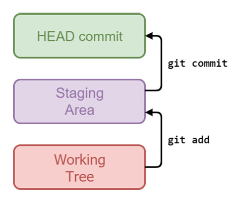
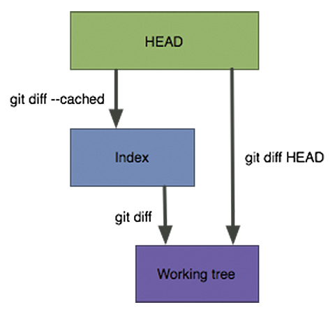
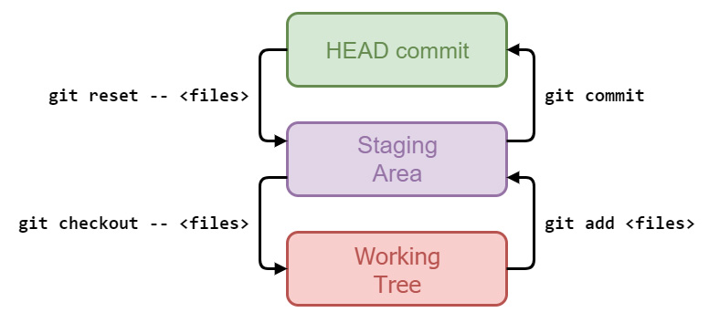

*Part eleven and last of the series, first published on [MokaByte](https://mokabyte.it/2018/02/13/git-11/) on 13 February 2018. The text stays as I wrote it then, with a note at the end about what changed.*

## Introduction

In the last instalment we saw a series of practical examples illustrating how the three areas Git uses to manage files work. In this article we continue to dig into the topic, trying to understand, even with a bit of abstraction, the "journey" files and their changes make through these areas, and the commands that allow it.

### The three areas of Git

As we know by now, in Git we work on three different levels:

- the **working tree**;
- the **staging area** (or **index**, or **cache**);
- the **HEAD commit**, that is, the last commit made on the current branch.

When we modify a file, we are doing it at the **working tree** level; when we run **git add**, we are actually copying the changes from the **working tree** to the **staging area**. At the end, when we make a **commit**, we finally move the changes from the **staging** **area** into a new **commit**, which **HEAD** refers to, and which will become part of the history of our repository: this is what I mean by "**HEAD commit**". Figure 1 shows an example picture of these three areas.



*Figure 1 – The three areas of Git.*

We can move changes between these areas "forward", from the **working tree** towards the **HEAD commit**, but we can also go "backward", undoing the changes we made if we want.

We already know how to "go forward" using **git add** and then **git commit**; let us take a look at the commands to "go back".

## Removing changes from the staging area

In normal daily work, it can happen that you add changes to the **staging** **area**, only to realise they would be better in a **separate** **commit**, and not in the one you are putting together right now.

To remove such changes to one or more files from the **staging** **area**, you can use the **git reset HEAD <file>** command; go back to the shell for a moment and follow me.

Let us start by checking the state of the repo again:

```
 [1] ~/es03 (master)
 $ git status
 On branch master
 Changes to be committed:
 (use "git reset HEAD <file>..." to unstage)
 modified:   cancelleria.txt
 Changes not staged for commit:
 (use "git add <file>..." to update what will be committed)
 (use "git checkout -- <file>..." to discard changes in working directory)
 modified:   cancelleria.txt
```

This is the current situation, remember? We have a **papyrus** in the **staging** **area** and an extra **parchment** in the **working** **tree**.

Let us now do what we just described and type **git reset HEAD**:

```
 [2] ~/es03 (master)
 $ git reset HEAD
 Unstaged changes after reset:
 M       cancelleria.txt
```

### Modified, Added, Deleted

OK, Git confirms we successfully **unstaged** the changes, that is, we removed them from the staging area. The "**M**" on the left side stands for **Modified**; here Git is basically telling us that we have just removed from the **staging** **area** the **change** to a file already known (**tracked**, remember?).

If you create a new file and add it to the staging area, Git knows it is a new file; if you then **unstaged** it, Git would put an "**A**" on the left for **Added**, to remind us that we have just removed from the **staging** **area** the **addition** of a new file.

The same if you **unstaged** the **removal** of an **existing** file: a "**D**" for **Deleted**, meaning "deleted", would appear on the left.

### Non-destructive changes

OK, it is time to check what happened:

```
 [3] ~/es03 (master)
 $ git status
 On branch master
 Changes not staged for commit:
 (use "git add <file>..." to update what will be committed)
 (use "git checkout -- <file>..." to discard changes in working directory)
 modified:   cancelleria.txt
 no changes added to commit (use "git add" and/or "git commit -a")
```

OK, using the **git status** command we see that the **staging area** is now empty, there is no "staged" file. We only have an "unstaged" change, but what is this change? Did **git reset HEAD** delete the papyrus?

Let us check using the **git diff** command:

```
 [4] ~/es03 (master)
 $ git diff
 diff --git a/cancelleria.txt b/cancelleria.txt
 index 994cbbf..b1bb2a2 100644
 --- a/cancelleria.txt
 +++ b/cancelleria.txt
 @@ -1,3 +1,5 @@
 penna
 matita
 evidenziatore
 +papiro
 +pergamena
```

No, fortunately! The **git reset HEAD** command does not destroy the changes, it simply removes them from the staging area, so that they do not become part of the next commit.

Now that we have explored all the ways to **diff** between **working** **tree**, **staging** **area** and **HEAD** **commit**, let us summarise in figure 2 the commands to use to diff between the three areas.



*Figure 2 – The commands to use to diff between the different areas.*

### "Destructive" changes

Good, let us continue with our example; the changes we made to the **cancelleria.txt** file are plainly wrong, we did it on purpose, and so we need to undo them.

The command to perform this operation is **git checkout -- <file>**, as Git kindly reminds us in the output of the **git status** command:

```
 [5] ~/es03 (master)
 $ git status
 On branch master
 Changes not staged for commit:
 (use "git add <file>..." to update what will be committed)
 (use "git checkout -- <file>..." to discard changes in working directory)
 modified:   cancelleria.txt
 no changes added to commit (use "git add" and/or "git commit -a")
```

Let us therefore try running **git checkout -- cancelleria.txt**:

```
 [6] ~/es03 (master)
 $ git checkout -- cancelleria.txt
```

No reply message: we are facing another case where Git says nothing because everything went smoothly. Let us check the state again:

```
 [7] ~/es03 (master)
 $ git status
 On branch master
 nothing to commit, working tree clean
```

OK, we are in a clean situation, no more pending changes. Let us check the file content just to be sure:

```
 [8] ~/es03 (master)
 $ cat cancelleria.txt
 penna
 matita
 evidenziatore
```

And that is it! We have effectively removed **papyrus** and **parchment** from the stationery list. But be careful: at this point we have **definitively** **lost** them! Since those changes were only in the **working** **tree** and in no previous **commit**, there is no way to recover them, so be careful: **git checkout --** is a "destructive" command, and should be used *cum grano salis*.

Beyond that, we must remember that **git checkout** also overwrites the staging area; as you can see in figure 2, the **working tree** and the **HEAD commit** are not directly related: changes always pass through the **staging area**. We will come back to this concept later, when it is time to dig into the options of the **git reset** command.

## Reset and checkout

At this point you may have noticed that here we used the **reset** and **checkout** commands in a different way from what we did in previous instalments, and indeed that is so.

At first this can confuse people learning to use Git a little, because mentally it seems impossible to associate a single command with a single operation: the **same** **command** can be used in **different** **ways** to do **different** **things**. For example, you cannot say: "**git checkout** is the command to change branch" (or to inspect a commit, going into detached HEAD as we have already seen), since the same command can also be used to discard changes in the **working** **tree**, as we have just done.

### The importance of the double dash

The trick you can use to tell the two variants of these commands apart is to consider the **double dash** notation (`--`). So you can remember that "**git checkout** is the command to change branch" and "**git checkout --** is to undo local changes".

The same applies to the **git reset** command.

The double dash `--` is not really mandatory; if you run **git checkout <file>** or **git reset <file>** without `--`, in 99.99% of cases Git does what you expect. The **double dash** is needed when, by coincidence, there is a file and a branch with the same name: in this case Git must know whether you want to work on branches, and therefore for example move from the current one to another with **git checkout**, or whether you want to deal with files. In this situation, the double dash is the way to tell Git: "I want to work on files, not on branches".

Figure 3 now summarises all the commands to move changes between these three areas.



*Figure 3 – The commands to move changes between the three areas of Git.*

## Conclusions

With this article, and with the previous one, we should by now have learned enough about using the **checkout**, **reset**, **diff** and **status** commands, and have clearly in mind how files and the changes made to them travel from our working folder to a new commit in our repository, passing through the staging area.

In the next article we will finish exploring these three areas, looking in detail at how the state of files changes every time we run a reset or a checkout.

## 2026 note

The three areas and the "journey" of changes are the same. Three things to know if you are following the examples today:

- `git reset HEAD <file>` still works to remove a file from the staging area, but today Git suggests `git restore --staged <file>`, which does only that and cannot move the branch by mistake.
- `git checkout -- <file>` still works and is still destructive, but the dedicated command today is `git restore <file>`. Here too the advantage is a command that does one thing only.
- `git checkout <branch>` is still valid, but to change branch there is `git switch <branch>`. The confusion described in this article is exactly why Git introduced `restore` and `switch`.

This was the last part of the series: the "next article" announced in the closing paragraph was never published.
