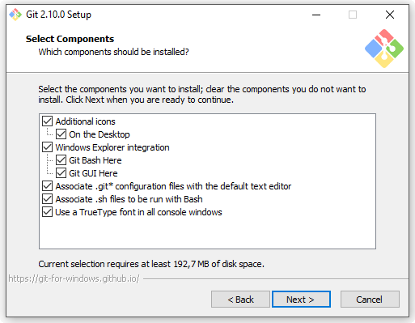
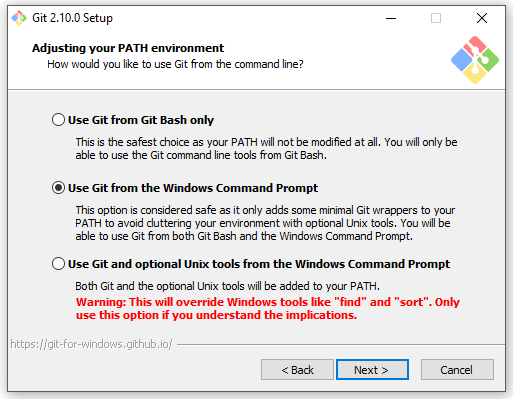
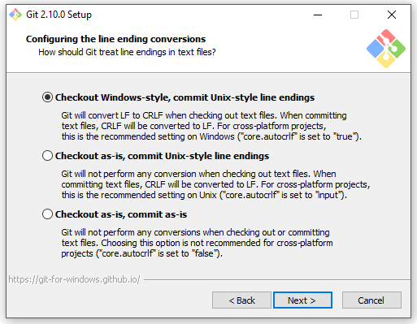
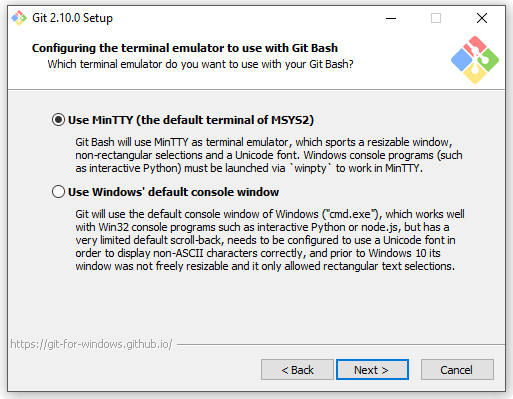
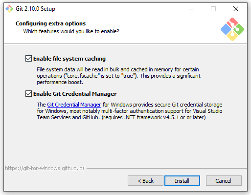
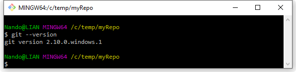
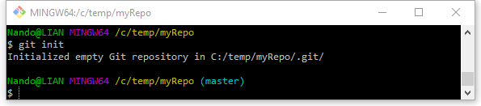
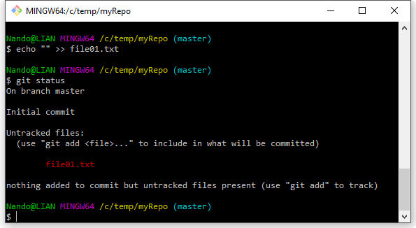
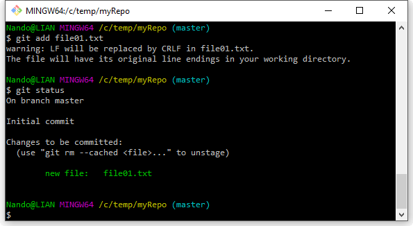
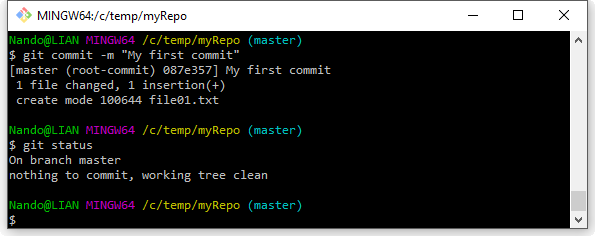

*Part two of the series, first published on [MokaByte](https://mokabyte.it/2016/10/11/git-2/) on 11 October 2016. The installer screenshots are from 2016 and the interface looks different today: the text stays as I wrote it then, with a note at the end about what changed.*

## Distributed vs Centralised

In the previous instalment we saw how Git came into being out of an emergency, a tool destined to revolutionise the world of **Distributed Version Control Systems (DVCS)**.

Before going on, let us spend a little time understanding the main differences between distributed and centralised systems, that is **Centralized Version Control Systems (CVCS)**.

To be honest, the systems that first appeared on the scene were neither centralised nor distributed. The first versioning system we can mention is [**Source Code Control System** (SCCS)](https://en.wikipedia.org/wiki/Source_Code_Control_System), dated 1972 and considered the grandfather of all versioning systems. It had been put together explicitly to track changes to files containing code, and it was made to work locally. The integrity of changes was guaranteed by simple but robust file locks: a file could be edited by one person at a time. The same goes for [**Revision Control System** (RCS)](https://en.wikipedia.org/wiki/Revision_Control_System), class of 1982, also focused on managing the versions of individual files through locks.

What these "**first generation**" versioning systems share is the fact that a version or revision is tied to the individual file, not to what we commonly call a **commit** today; it is only with the "**second generation**" of tools that, thanks to the much maligned [**Concurrent Versions System** (CVS)](https://en.wikipedia.org/wiki/Concurrent_Versions_System), we see a turning point: a collaborative approach is introduced, based on the concurrent integration of changes to multiple files. That is how the concept of **merge** is born. On top of that, the networking foundations laid by RCS allow CVS to introduce the concept of a **central server**, the single keeper of all changes made to a software project.

Git, on the other hand, belongs to what we can call the "**third generation**", the one of **distributed** or decentralised systems. Here the focus shifts back to the individual developer, who must always be free to work independently and in any condition, without losing the possibility of exchanging the changes made during their work with whomever they want, with or without a server in between.

So what is the difference between centralised and distributed versioning systems? Well, the answer is fairly easy: in centralised systems there is a central server; in distributed systems… there may be none, or one, or as many as we like. Is that all? Well, it is more nuanced than it sounds: in the coming articles we will see what this architectural change entails.

Now it is time to start experimenting.

## Installing Git

Installing Git is fairly simple; the first thing to do is get the installation package, which you can find on [**git-scm.com**](https://git-scm.com/); at the time the latest available version was **2.10.0**.

GNU/Linux users have it easiest, because they can install Git using their own package manager and because they get the full power of the tool, while on Windows and macOS there are a few small limitations; these are entirely negligible in daily work, though, and have never been a problem (at least for me).

From now on, for simplicity, we will use the Windows ecosystem as our reference; all examples will still run on all three platforms, unless explicitly stated otherwise.

Once you have downloaded the Windows installer (x86 or x64 depending on your system), a double click is enough to start the installation. The procedure is nothing complicated, but there are a couple of details worth highlighting. The screenshots that follow are the 2016 ones: the order and the meaning of the questions are the same today, the look has changed.

The first screen asks which components you want to install:

*Figure 1 – Choosing the components to install.*

Personally I find it useful to install everything, and in particular I find "**Windows Explorer integration**" very handy, because it keeps Git one right click away.

Moving on, we are asked how deeply we want Git to integrate with our Windows system:

*Figure 2 – Choosing the level of integration with the system.*

Here too I recommend the default option, the second one. Even though I normally do not use Git from the DOS prompt, selecting this option makes the **git** command universally available to our Windows system, allowing us to install GUIs, editors and graphical tools that rely on it later.

At this point we have to decide how to handle one of the most annoying problems when working across platforms, namely line endings in text files:

*Figure 3 – Handling line endings in text files.*

This decision should not be taken lightly, because it can cause problems later while using Git: line endings that keep changing every time we "put a file in and take it out" of Git would be a real headache. Luckily the default option suits us here too; by selecting the first item we make sure that every file Git hands to the operating system (downloading it from a server or fetching it from a local branch) is "fixed" to always have Windows-style line endings, that is CRLF; when instead, using the proper commands, we ask Git to track our changes to a set of files, before storing them in its internal archives it will automatically convert the endings to LF, as Unix demands. This saves us from constant reports of differences caused by line endings alone.

Someone may be wondering what Unix has to do with it: why should I care about Unix line endings, we are not on Windows? Good question.

The point is that when we install Git on Windows, in practice we are pulling "half of Linux" in with it; when Git was designed, Linux was the reference platform, remember? Being on Linux, then, Linus Torvalds & co. certainly did not hold back in using tools and utilities available on the penguin's operating system, as is only natural.

Today, then, we find ourselves in a situation where Git depends on a lot of small programs that exist on Linux-based systems, and to make it work outside Linux too we had to carry all that baggage of small and large tools along.

That is why I said earlier that I generally do not use Git from the MS-DOS prompt; once Git is installed I have [Bash](https://en.wikipedia.org/wiki/Bash_(Unix_shell)) available, one of the most famous shells in the GNU/Linux world, and a good slice of Linux command-line tools (from **grep** to **awk**, just to name a couple). At this point, since the effort has been made, it is worth taking advantage of the powerful Bourne Again SHell and leaving the old DOS prompt aside.

With the line endings chapter closed, we can move on; the next screen asks which terminal emulator we want to use:

*Figure 4 – Choosing the terminal emulator.*

We already said how convenient it is to be able to use Bash on Windows; the choice can therefore only fall on **MinTTY**, a terminal emulator that, after many other famous attempts, seems to have finally given even the unlucky Windows users an emulator worthy of the name.

Finally, a couple of other small treats that recently landed in the Windows version of Git.

*Figure 5 – Further options: file system caching and credential manager.*

"**System caching**", as the description itself says, speeds Git up by running some of the heaviest operations in memory.

"**Git Credential Manager**" solves another well-known annoyance, having to type your password at every interaction with a remote Git server. This inconvenience comes from the fact that Linux's user and credential management is completely different from Windows', which made adapting Git quite hard from the start. Luckily, a few versions ago the open source project "Git Credential Manager", born inside Microsoft, was integrated to work around the problem.

At this point, clicking "next" the installation copies the necessary files. At the end, I recommend a quick read of the changelog too, to understand the limits of the Windows edition of Git and to become aware, at least superficially, of the differences between the two editions.

## Creating our first repository

Now that Git is installed, it is time for a first small experiment.

Let us create a temporary folder, for example `C:\temp\myRepo`; go inside it and, using the right-click integration, select "**Git Bash Here**": a nice colourful terminal will open. First of all, let us check that Git works; type **git --version** and press enter:

*Figure 6 – Checking that everything works.*

Git will answer by printing the currently installed version to the console. If it does not, the installation probably did not succeed and should be run again.

At this point let us try to create our first repository; type the following command, **git init**:

*Figure 7 – Creating a new repository.*

Git will answer by initialising a new repository inside the folder we are in; as you will have noticed, the operation is very fast and requires no parameters or remote server: Git creates the repository locally, and it is up to us to decide if and when to "publish" it to a server.

Initialising a repository boils down to creating a "dot-folder" inside the folder we are in, called "**.git**". This folder, usually marked as "hidden" in Windows, contains all the files Git uses to manage the repository; for now let us settle for knowing this, later on we will try to peek inside and look at its contents.

One last thing worth noting is that, with a Git repository, everything needed to make it work lives inside the folder where we initialised it; so if tomorrow you decided to move your repository from `C:\temp\myRepo` to `C:\Projects\myRepo`, everything would keep working normally.

Another observation concerns folder paths; as you can see, Bash uses the typical Linux notation, based on the **forward slash** (`/`) as folder separator; for anyone not used to Linux or another "Unix based" system such as macOS, this will look strange, but you get used to it quickly.

One last small observation concerns the blue word, "**(master)**": what does it mean? The Bash shell we are using is configured by default to show, when we are inside a Git repository, the name of the **branch** we are currently on; and indeed Git, as soon as we initialise a repository, also creates a branch called **master**, a convention that has existed since the early days. The master branch is the main branch inside a repository, and even though Git can manage as many branches as we want, we can be sure that in every Git repository we use there will always be at least one branch, and its name will be master.

I have just mentioned branches, hoping that whoever is reading has already used a versioning system at least a little and therefore knows what we are talking about; if not, [Wikipedia](https://en.wikipedia.org/wiki/Branching_(version_control)) can help you get familiar with the typical vocabulary of versioning systems.

Now let us go on to creating our first commit. First, let us create a simple text file inside our repository and see how Git reacts:

*Figure 8 – The first commit.*

After creating the file with a simple **echo** command, we typed **git status**, one of the commands we will use most often; this command gives a snapshot of the current state of the repository, showing us which files need our attention (because they were modified, added, deleted, etc.). In this case Git tells us that it noticed a new file in the repository, and that this file is not "tracked" yet.

But what does "tracked" mean? It means that, to make Git start taking care of the changes we make to that file, we have to tell it explicitly, using the **git add** command. This behaviour highlights two fundamental aspects of Git: the first is that Git, as its own author said, is "stupid": it does nothing on its own initiative; the second, a consequence of the first, is that if I want to track the changes made to a file it is not enough for it to be added to my repository folder, as happens for example with Subversion, but I have to point at it explicitly. In the coming articles we will understand better why it behaves this way.

So let us add our file to the list of tracked files, using the command **git add <file-name>**:

*Figure 9 – Adding our file to the list of tracked files.*

Git, as you will have noticed, shows a warning about the line endings we talked about earlier; having used the **echo** command to generate the file inside the Bash shell, it ended up with the LF endings typical of Linux, because, as you will remember, working in Bash is equivalent to working in a small Unix-like system (ok, not exactly, but allow me the comparison for the sake of simplicity). Git therefore warns us that it will change them on our behalf, as we asked it to do when we installed it.

Apart from this small detail, Git says nothing else; to realise what happened, let us run **git status** again: we will notice that our file is now among those known to Git; in particular, our versioning system tells us that this file is new to it, that is, this is the first time it has been asked to track it. Let us ignore the messages Git prints for a moment and move towards our goal; we therefore issue the last command we will see today, **git commit**, through which we will "freeze" the state of our file in the repository:

*Figure 10 – "Freezing" the state of our file in the repository.*

To the **git commit** command we added the **-m** option (**--message** in its extended form), which lets us write the desired comment on the same line, alongside our commit.

## Conclusions

At this point our first small mission is accomplished: we have a Git repository, and inside it we have added a file. In the next instalments we will look more closely at the structure of Git repositories and learn to know and use some of the main commands.

## 2026 note

The screenshots are from 2016 and the Windows installer looks different today, even though the questions are largely the same. Three things to know if you are following the steps today:

- The branch created by `git init` is no longer called `master` by default, but `main`. Commands and concepts do not change: the label you see in the prompt does.
- The version shown in the screenshots is 2.10.0, the one from back then. Git has now gone past 2.50 and `git --version` will show you yours.
- The option about line endings is still there and is still worth leaving on the default. It is the advice in this article that has aged best.
