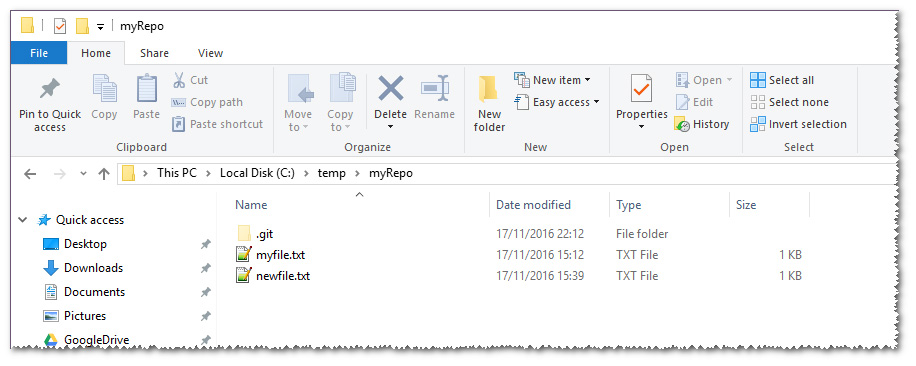
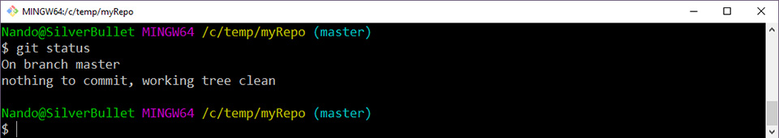
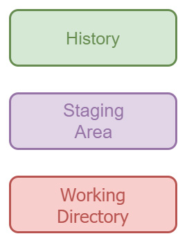
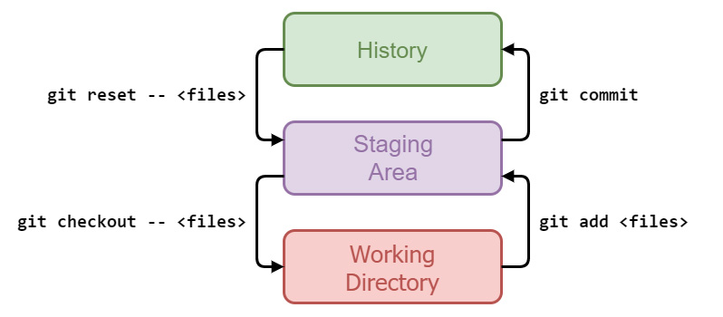

*Part three of the series, first published on [MokaByte](https://mokabyte.it/2017/01/13/git-3/) on 13 January 2017. The text stays as I wrote it then, with a note at the end about what changed.*

## The three "places" of Git

In the previous article we saw how to **install** **Git**; once the environment was ready, we then did some first experiments, starting to get familiar with the tool and with some of its simplest commands.

In this new instalment we will look at some **fundamental concepts** which, once absorbed, will also let us understand the more complex command sequences and operations.

The structure of a Git repository has **three different areas** (Working Directory, History, Staging Area), through which our files become part of its history. Understanding what they mean is the goal of this instalment, and to reach it we will go through the set of commands and options that let us perform all the necessary operations.

### The Working Directory

In the previous instalment we created an empty folder (**C:\temp\myRepo**) and initialised a new Git repository with the **git init** command.

From that moment on we can call this folder a **local repository**. This folder contains everything needed to make the repository work, and it is consistent: you can in fact move the folder without compromising either the repository or any file inside it.

Inside every local Git repository we find the **.git** subfolder; it is a so-called **dotfolder**, that is, a folder whose name starts with a dot; this convention, common on Unix-like systems such as Linux, also started to be used in software packaged for the Windows platform. These folders usually hold **configuration** and/or **intermediate** files that the application needs in order to work properly.

In the case of Git, this folder contains the configuration of the current repository and several files that we will learn to know over time. Note: on Windows this folder is hidden; if you cannot see it, you need to change the system settings so that hidden files and folders are visible too.



*Figure 1 – The .git dotfolder: on Windows it is hidden, so you need to make hidden folders visible.*

The files and folders that sit outside the **.git** dotfolder make up what is called, in jargon, the **working directory**. It holds the files that represent the current state of the branch we are on and, to be precise, the "photograph" updated to the last commit made.



*Figure 2 – We are on the master branch and no change is in progress.*

As you can see in figure 2, we are in fact on the **master** branch, and our current state is "**nothing to commit, working tree clean**". This means no change is in progress, so the files inside our **working** **directory** are identical to those already present in the last **commit**.

### The History

By **History** we mean the "story" of our repository; just as in nature time is marked by events, our repository is also made of an ordered succession of elements, the **commits**.

When a repository is born, with the **git init** command, and when we make a commit for the first time, we start a sequence of chained elements, each of which will be indissolubly tied to the one before it. This series of commits already present in our repository is precisely the history, and the last commit made will be the state Git refers to in order to highlight the changes we will make over time in our **Working** **Directory**.

Between **History** and **Working** **Directory**, however, there is a third zone, the **Staging Area**.

### The Staging Area

The **Staging Area** (often also called the **index**) is an intermediate area that sits between the **Working Directory** and the **History** (figure 3).



*Figure 3 – The Staging Area sits between Working Directory and History.*

The concept of **Staging Area** is one of those that trouble people used to other version control systems the most, because it is new to them; in [Subversion](https://en.wikipedia.org/wiki/Apache_Subversion), for example, there are only two **places**: the **remote server**, which holds the history of all commits made before, the history above, and your folder on disk, the working directory, holding the files downloaded from the server. When you change the state of your folder by modifying, adding or deleting files, **Subversion** notices the change and accordingly proposes sending the updates to the server: the explanation is necessarily simplified, and Subversion experts should forgive me.

In Git, on the other hand, there is this intermediate area, where you add, time after time, the changes you want to include in the next **commit**; in the previous article we saw how to tell Git to track a new file, using the **git add** command; it will always be with the **git add** command that we tell Git, time after time, to include in the next commit the changes made to files and folders in our Working Directory.

But what is the point of having an intermediate area? Very often this confuses people, because it is seen as a useless nuisance, an extra step, moreover mandatory, that provides no benefit at all.

### Reasons in favour of the Staging Area

We will now try to understand together why this **level of separation** is useful instead, even if only marginally, since it is only when we have become familiar with more complex commands that we will fully appreciate its real usefulness.

Has it ever happened to you to have **too many** changes to commit? Or changes of a **different** **nature**, so that it is useful to group them into two or more commits? One of the things you can do with the staging area is precisely this: include in it only **part** of the **changes** in progress, so that another separate commit is then possible. Subversion users will already be thinking: "but you can do that in SVN too!". True, Subversion also allows you to exclude added, modified or deleted files from the commit you are about to make (see, on this point, [Subversion changelists](https://svnbook.red-bean.com/en/1.8/svn.advanced.changelists.html)).

Git, however, also lets you do something more: for instance, among the various successive changes made to the same file, you can include only some of them in the next commit, leaving the others pending.

Useful, don't you think? Personally I always try to make **small**, **self-contained** **changes**, so the problem rarely arises for me, but when I fail and end up in situations like these, I know that in Git's toolbox there is the **--patch** (or **-p**) option which, used together with the **git add** command, lets me define with surgical precision which changes to a file to include in the commit being prepared.

For now let us settle for this; in the future we will see how useful it is for handling integrations between different development branches.

## Git internals

The time has come to see how Git manages these three areas, which commands interact with them and what practical effect those commands have.

The commands we will use are (**git**) **add**, **commit**, **reset** and **checkout**.

### git add

We have already learned to know the **git add** command; in the past we said that its job is to tell Git to track the changes made to a file. Internally, however, Git does nothing but copy the file from the **Working** **Directory** to the **Staging** **Area**. When we run the **git status** command to see the current state of the repository and Git tells us that a file is modified, it is simply because the copy of the file in the Staging Area differs from the one in the Working Directory.

### git checkout

If, for example, we wanted to undo the changes to a file not yet added to the Staging Area, we can use the **git checkout** command, which does nothing but copy the file from the Staging Area to the Working Directory, bringing it back to its previous state.

### git commit

To safely archive the changes made we have seen that the **git commit** command is used, with which we create a fixed point in the history of our repository.

### git reset

If at some point we wanted to remove the changes added to the Staging Area but not yet committed, we can use the **git reset** command, which does nothing but copy the file present in the last commit of the History into the Staging Area: this brings the situation back to when our changes were not "**staged**", that is, added to the staging area.

### A summary picture

Figure 4 shows a summary table of what has just been illustrated.



*Figure 4 – The relationships between the three areas of Git and the commands that move between them.*

Note the **double dash** `--` that follows the **checkout** and **reset** commands; this double dash does not alter the behaviour of the two commands, but makes their use more explicit. As we will see later, besides restoring files, **checkout** and **reset** are also used when interacting with **branches**; during your work some unfortunate situations may arise in which Git does not know what to do: in such cases the double dash `--` becomes indispensable. But let us look at an example to understand better.

Take **git checkout**, which is also used to switch from one branch to another, and suppose that in our repository, besides **master**, there is also a branch named **hello** and also a file with the same name, which has been modified in the meantime. At this point, if we issue the command **git checkout hello**, Git cannot uniquely determine our intentions: do we want to undo the local changes to the "hello" file, or do we want to switch branch? In cases like this the **double** **dash** is needed to tell Git that we are in the first case, that is, we want to take the "hello" file back from the Staging Area, undoing the local changes. Using the **double** **dash** `--` is not mandatory, since in most cases Git "understands by itself" which case we are in, but using it is still good practice to avoid unpleasant surprises, especially now that we know its meaning and rationale. For more information see the [git checkout documentation](https://git-scm.com/docs/git-checkout).

## Exercises

The time has come to check whether we have grasped the concepts above; let us try to run a few small exercises together.

### Exercise 1: undoing a change not yet added to the staging area

Just to review a little, let us start from scratch; this is the plan:

1. initialise a new repository with **git init**;
2. create a txt file with one line of text inside;
3. add it to the staging area with **git add**;
4. make the first commit with **git commit**.

Now that we have a first commit, let us get to the heart of our exercise:

1. modify the file;
2. check the state with **git status**: the file will be shown as modified;
3. undo the changes with **git checkout --**

Below is the sequence of commands typed in the Bash shell on Windows; any "#text starting with a hash" is a comment added here to better highlight the key steps.

```bash
Nando@SilverBullet MINGW64 /c/temp/es01
$ git init #initialise a new repository in an empty folder
Initialized empty Git repository in C:/temp/es01/.git/

Nando@SilverBullet MINGW64 /c/temp/es01 (master)
$ vim file01.txt # use Vim or another editor to create and edit a new file

Nando@SilverBullet MINGW64 /c/temp/es01 (master)
$ git add file01.txt #add file01.txt to the staging area

Nando@SilverBullet MINGW64 /c/temp/es01 (master)
$ git commit -m "First commit, file01" #make the first commit on our repo
[master (root-commit) 4f9647b] First commit, file01 #root commit = first commit
 1 file changed, 1 insertion(+)
 create mode 100644 file01.txt

Nando@SilverBullet MINGW64 /c/temp/es01 (master)
$ vim file01.txt #modify the file as you like, e.g. by adding a second line of text

Nando@SilverBullet MINGW64 /c/temp/es01 (master)
$ git status #check the current situation
On branch master
Changes not staged for commit:
  (use "git add <file>..." to update what will be committed)
  (use "git checkout -- <file>..." to discard changes in working directory)
        modified:   file01.txt #the file is shown as modified
no changes added to commit (use "git add" and/or "git commit -a") #the file has not been added to the staging area yet

Nando@SilverBullet MINGW64 /c/temp/es01 (master)
$ git diff #git diff shows the differences
diff --git a/file01.txt b/file01.txt
index d60cfd3..0a00f55 100644
--- a/file01.txt
+++ b/file01.txt
@@ -1 +1,2 @@
 This is file 01   #this is the line of text already in file01.txt
+Adding a second line #this is the line just added
\ No newline at end of file

Nando@SilverBullet MINGW64 /c/temp/es01 (master)
$ git checkout -- file01.txt #the key moment: I undo my local changes

Nando@SilverBullet MINGW64 /c/temp/es01 (master)
$ git status #ok, now Git tells me there are no differences left
On branch master
nothing to commit, working tree clean
```

### Comments on exercise 1

One last comment before closing the exercise: **git checkout --** undoes your local changes to the files indicated, and those changes will be irretrievably lost! So be careful with commands like **git checkout -- .** (which means "undo all local changes to tracked files"), you might lose important changes to other files you did not remember at that moment.

### Exercise 2: removing a modified file from the staging area

Let us keep what we did before: our repo with a first commit made.

1. modify file01.txt
2. check: the file will be shown as modified, outside the staging area (text in red);
3. add the modified file to the staging area with **git add**
4. check: the file will be shown as modified and included in the staging area (text in green);
5. remove the file from the staging area with **git reset --**

Below is the sequence of commands typed in my personal bash on Windows.

```bash
Nando@SilverBullet MINGW64 /c/temp/es01 (master)
$ vim file01.txt #modify the file as you like, e.g. by adding a line of text

Nando@SilverBullet MINGW64 /c/temp/es01 (master)
$ git status #check the current situation
On branch master
Changes not staged for commit:
  (use "git add <file>..." to update what will be committed)
  (use "git checkout -- <file>..." to discard changes in working directory)
        modified:   file01.txt #the file is shown as modified, but is not in the staging area yet
no changes added to commit (use "git add" and/or "git commit -a")

Nando@SilverBullet MINGW64 /c/temp/es01 (master)
$ git add file01.txt #add the file to the staging area

Nando@SilverBullet MINGW64 /c/temp/es01 (master)
$ git status
On branch master
Changes to be committed:
  (use "git reset HEAD <file>..." to unstage)
        modified:   file01.txt #now the file is included in the staging area

Nando@SilverBullet MINGW64 /c/temp/es01 (master)
$ git reset -- file01.txt #the key moment: we remove the file from the staging area
Unstaged changes after reset:
M   file01.txt
#Git shows us here the "unstaged" changes, that is, those removed from the staging area
#M stands for Modified; we might find A for Added and D for Deleted, if we respectively decided not to add a file any more or not to go ahead with its deletion in the next commit

Nando@SilverBullet MINGW64 /c/temp/es01 (master)
$ git status #check the situation again
On branch master
Changes not staged for commit:
  (use "git add <file>..." to update what will be committed)
  (use "git checkout -- <file>..." to discard changes in working directory)
        modified:   file01.txt #we are back to the file being outside the staging area
no changes added to commit (use "git add" and/or "git commit -a")
```

### Comments on exercise 2

The **git reset** command is a very powerful one, and with it you can perform a wide range of operations. In this specific case we used it to remove from the staging area a file modified earlier, which happens for instance when we do not want the changes it contains to be part of the next commit, but want to keep them "on the bench" for the following one. In this case **git reset** does not "destroy" our local changes: in fact it does the opposite of **git add**. But **git reset** can also become dangerous when called with other parameters and options: we will look at this aspect in a future article, and for now just know that this command should be used with caution anyway.

## Conclusions

In this third part we opened the bonnet and started taking a look at the engine, observing more closely how the commands we issue move Git's machinery.

The road ahead still has a few fundamental stops before its internal workings are clear. In the next instalments we will go even deeper, analysing in detail the operations Git performs in order to store files and changes we make inside our repository.

## 2026 note

The concepts in this instalment have not changed: working directory, staging area and history are still the three areas of Git, and `git add`, `git commit`, `git reset` and `git checkout` still do what you read here. What changed are the names of some things:

- The branch created by `git init` is no longer called `master` by default, but `main`. In the figures and examples from back then you will read `master`.
- `git checkout -- <file>` still works, but today Git suggests `git restore <file>` to restore a file from the staging area. It is the same command with a clearer name, born because `git checkout` did too many things at once.
- To remove a file from the staging area without losing the changes, `git reset -- <file>` still works; the modern alternative is `git restore --staged <file>`.
- To switch branch, `git checkout <branch>` is still valid but the dedicated command today is `git switch <branch>`.

If you are following the exercises on a recent version, expect slightly different `git status` messages from the ones in the screenshots: Git now suggests `git restore` where it used to suggest `git checkout --`.
