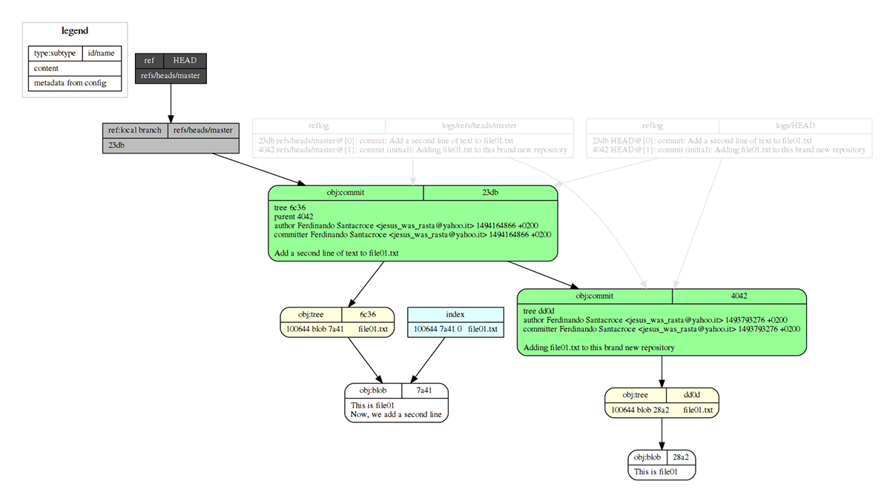

*Part six of the series, first published on [MokaByte](https://mokabyte.it/2017/05/15/git-6/) on 15 May 2017. The text stays as I wrote it then, with a note at the end about what changed.*

## Blobs, trees and… commits

In the last instalment we put two of Git's **objects** under our magnifying glass; we are talking about **blobs**, which in fact preserve our files inside a repository, and **trees**, which instead hold all the information needed to rebuild the structure of files and directories of our repository at any **instant**.

These **instants**, these **snapshots** we take to track the important moments in the life of a repository, are represented by **commits**, which we will now discuss in more detail.

## Commits

Like the other **objects**, commits too are represented by a file inside the **.git** folder; let us review a little of what we have done so far and make a **commit** in a new repository, so that we can then check its structure and content:

```
[1] /home
$ mkdir es02

[2] /home
$ cd es02/

[3] /home/es02
$ git init
Initialized empty Git repository in home/nando/es02/.git/

[4] /home/es02 (master)
$ touch file01.txt

[5] /home/es02 (master)
$ vi file01.txt

[6] /home/es02 (master)
$ git add file01.txt
warning: LF will be replaced by CRLF in file01.txt.
The file will have its original line endings
in your working directory.

[7] /home/es02 (master)
$ git commit -m "Adding file01.txt to this brand new repository"

*** Please tell me who you are.

Run

  git config --global user.email "you@example.com"
  git config --global user.name "Your Name"

to set your account's default identity.
Omit --global to set the identity only in this repository.

fatal: no name was given and auto-detection is disabled

[8] /home/es02 (master)
$ git config user.email "jesus_was_rasta@yahoo.it"

[9] /home/es02 (master)
$ git config user.name "Ferdinando Santacroce"

[10] /home/es02 (master)
$ git commit -m "Adding file01.txt to this brand new repository"
[master (root-commit) 404276b]
Adding file01.txt to this brand new repository
  1 file changed, 1 insertion(+)
  create mode 100644 file01.txt
```

### The steps of the commit

Let us summarise the actions performed by the various commands issued:

1. Create the "**es02**" folder.
2. Enter the folder.
3. Initialise a new repository with the **git init** command; as a result the **.git** folder is created inside the **es02** folder.
4. Create a new file called **file01.txt**.
5. Edit the file, writing "**This is file01**" inside it.
6. Add the file to the repository.
7. Try to commit the file just added, but get an error; this behaviour comes from a particular configuration of mine which, once enabled, forces you to specify the user name and email you want to use for every new repository created; this way I avoid committing code I modify for work with a personal account and vice versa. If you are wondering, the **flag** to enable is **useconfigonly**, and you can do it by typing the command **git config --global user.useconfigonly true**.
8. Configure the user's email.
9. Configure the user's name.
10. Try the commit again, this time successfully.

## Analysing the commit

Let us now take a look at the commit just made; using **git log**, we see the main information:

```
[11] /home/es02 (master)
$ git log
commit 404276b63bdfb2aa99dbff4bb25a1d5d51f35e85
Author: Ferdinando Santacroce <jesus_was_rasta@yahoo.it>
Date:  Wed May 3 08:34:36 2017 +0200

  Adding file01.txt to this brand new repository
```

Among this information we find:

- **commit**: the hash of the commit; like every object, commits too are marked by a unique SHA-1 hash, and they too are saved in the **.git** folder together with trees and blobs.
- **Author**: the author of the commit, followed by their email.
- **Date**: the date the commit was made.
- The **comment** attached to the commit.

These are the main pieces of information of a commit, the ones you usually care about in 99% of cases; we, instead, will go deeper, to try to understand better how commits follow one another inside a repository.

### More information about a commit

Let us start by reading more carefully the output given by command number **10**; to our commit, Git replied like this:

```
[10] /home/es02 (master)
$ git commit -m "Adding file01.txt to this brand new repository"
[master (root-commit) 404276b]
Adding file01.txt to this brand new repository
  1 file changed, 1 insertion(+)
  create mode 100644 file01.txt
```

Let us start from what is enclosed in square brackets; **master** indicates the name of the branch on which the commit was made; as we said before, **master** is the default branch created in every Git repository… a bit like the trunk in Subversion, for those used to it.

In round brackets, instead, we find **(root-commit)**, wording we will never see again in this repository; the first commit is in fact a slightly different commit from all the others we will make, because unlike the others it has **no** "parent" (a commit that precedes it).

To rebuild the history of a repository, Git adopts a very simple, yet very effective technique: it ties every single commit to the one before it. This way, starting from any commit in the repository, be it the last one or one chosen at will, it will always be possible to walk the **tree** of the **repository** **backwards**, going from a commit to the one before it, and then further back until reaching the root commit, the starting point of the repository's history.

## A new commit

Let us now make a new **commit**, which involves modifying the file added earlier:

```
[12] /home/es02 (master)
$ vi file01.txt

[13] /home/es02 (master)
$ git status
On branch master
Changes not staged for commit:
  (use "git add <file>..." to update what will be committed)
  (use "git checkout -- <file>..." to discard changes in working directory)

    modified: file01.txt

no changes added to commit (use "git add" and/or "git commit -a")

[14] /home/es02 (master)
$ git add file01.txt
warning: LF will be replaced by CRLF in file01.txt.
The file will have its original line endings
in your working directory.

[15] /home/es02 (master)
$ git commit -m "Add a second line of text to file01.txt"
[master 23db710] Add a second line of text to file01.txt
  1 file changed, 1 insertion(+)

[16] /home/es02 (master)
$ git log
commit 23db710a782af7c177c96bdb9b0359aa227a203c
Author: Ferdinando Santacroce <jesus_was_rasta@yahoo.it>
Date:  Sun May 7 15:47:46 2017 +0200

   Add a second line of text to file01.txt

 commit 404276b63bdfb2aa99dbff4bb25a1d5d51f35e85
 Author: Ferdinando Santacroce <jesus_was_rasta@yahoo.it>
 Date:  Wed May 3 08:34:36 2017 +0200

   Adding file01.txt to this brand new repository
```

### Looking "inside"

Let us discover how Git builds this kind of relationship between commits; using the **git** **cat-file -p** command, let us look at the content of the second commit made:

```
[17] /home/es02 (master)
$ git cat-file -p 23db710
tree 6c36fbd1d748731c46cb12eec5900780d3a0caa5
parent 404276b63bdfb2aa99dbff4bb25a1d5d51f35e85
author Ferdinando Santacroce <jesus_was_rasta@yahoo.it> 1494164866 +0200
committer Ferdinando Santacroce <jesus_was_rasta@yahoo.it> 1494164866 +0200

Add a second line of text to file01.txt
```

In order, we find:

- **tree**: it shows the hash of the tree object containing everything, that is, the "root" folder of our repository, in the state it is now. With the knowledge gained so far, we already know that this tree will contain the blob object holding our **txt** in its current state, that is, with two lines of text, one added in the first commit and one in the second.
- **parent**: it shows the hash of the commit preceding the one we are analysing; here is the magic revealed: as said earlier, every commit contains a reference to the commit before it, except the root commit of course, and this reference is nothing but the SHA-1 hash of the commit.
- **author**: it shows the author of the commit.
- **committer**: it shows the one who made the commit; you will be asking: "But why are they distinct? Are author and committer not always the same person?". Yes, they usually are, but on particular occasions it may be necessary to commit code on someone else's behalf; in such cases, to make this explicit, you can make a commit specifying its author, so that the repository history keeps track of the fact that the commit was made by one person, but on behalf of someone else. For those interested, the option to use is **--author**, as in the example **git commit --author="Author Name <email@address.com>"**.
- An empty line.
- The commit message.

Let us look instead at the content of the root commit, the first commit made:

```
[18] /home/es02 (master)
$ git cat-file -p 404276b
tree dd0d89f1f32bc8b3cc9d9b4491c71075b8971206
author Ferdinando Santacroce <jesus_was_rasta@yahoo.it> 1493793276 +0200
committer Ferdinando Santacroce <jesus_was_rasta@yahoo.it> 1493793276 +0200

  Adding file01.txt to this brand new repository
```

As you will have noticed, this commit has **no** reference to a **parent**; this is enough for Git to establish that it is the **root** **commit**; so, once here, this is the only place where a backward walk from any commit to the origin of everything will end.

## The shape of the repository

Below is a graphical representation (figure 1) with a detailed diagram of the current structure of the repository just created; you can see **trees** (in yellow), **blobs** (in white), **commits** (in green) and all the relationships between them, shown as directed arrows. The image is generated with [git-draw](https://github.com/sensorflo/git-draw).



*Figure 1 – The structure of the repository: trees in yellow, blobs in white, commits in green.*

Note how the arrow joining the commits goes from the second commit towards the first, that is, from the descendant to its ancestor; it may look like a detail, but it matters that in graphical representations like these the direction is correctly shown, to highlight properly the relationship between commits: it is always the child that depends on the parent.

You can also see things still unknown to us (**refs**, in light and dark grey, and **reflog** in a semi-transparent stroke), which we will soon get to know.

Having seen and analysed this last image, you should no longer have trouble visualising the structure of a Git repository, or at least the part concerning the storage of files and folders inside it through the composition of a commit.

## Conclusions

This ends our exploration of the world of Git objects; only tags are left out, and we will look at them in the future. In the next instalments we will open a new chapter dedicated to **references**, that is, the system Git offers us to move from one point to another inside a repository.

## 2026 note

The structure of a commit is the same: a tree, zero or more parents, author, committer and message. Two things to know if you are following the examples today:

- The initial branch is no longer called `master`, but `main`. The hashes in the examples are from 2017 and you will not find them identical: they depend on dates, names and content.
- The `fatal: no name was given and auto-detection is disabled` error comes from the `user.useconfigonly` setting I described in the article. It is not Git's default behaviour: without that setting, Git tries to infer name and email from the system and only warns you when it cannot.
