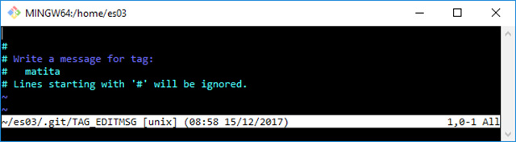

*Part nine of the series, first published on [MokaByte](https://mokabyte.it/2017/12/15/git-9/) on 15 December 2017. The text stays as I wrote it then, with a note at the end about what changed.*

## Tags: "milestones" in a repository

In this new instalment of the Git series, let us take a look at **tags**; as you know, tags are "milestones" inside a repository, and are often used to mark an important step in the evolution of our project, for example a new release.

In this article we will see how Git can manage **tags**, and what features it offers us.

## Tags are fixed labels

**Tags** are **labels** that can be applied to a **commit**, but, unlike **branches**, these **tags** will stay "stuck" to the same **commit** forever.

Creating a tag is simple: you only need the **git tag** command, followed by a name of your choice that follows the same conventions we saw in the past for **branches** (you can find them in [git-check-ref-format](https://git-scm.com/docs/git-check-ref-format)); to try it, let us create one on the "tip commit" (that is, the last one) of the **bevande** branch; let us take our **repository** again and check out the **bevande** branch:

```
 [1] ~/es03 (snack)
 $ git checkout bevande
 Switched to branch 'bevande'
 [2] ~/es03 (bevande)
 $ git log --graph --decorate --oneline --all
 * e29f5c6 (snack) Aggiunge lista snack a disposizione per l'ufficio
 | * 4072e76 (HEAD -> bevande) Aggiunge l'acqua alle bibite
 |/
 * 87cacc7 (master) Aggiunge una matita
 * 6cf12f4 Aggiunge una penna alla lista della cancelleria
```

### git tag

Let us now use the **git tag** command followed by a name we like, for example **acqua**:

```
 [3] ~/es03 (bevande)
 $ git tag acqua
```

Let us see what the Git log says:

```
 [4] ~/es03 (bevande)
 $ git log --graph --decorate --oneline --all
 * e29f5c6 (snack) Aggiunge lista snack a disposizione per l'ufficio
 | * 4072e76 (HEAD -> bevande, tag: acqua) Aggiunge l'acqua alle bibite
 |/
 * 87cacc7 Aggiunge una matita
 * 6cf12f4 Aggiunge una penna alla lista della cancelleria
```

As you can see in the log, on the "leaf" of the **bevande** branch there is now also a **tag** called **acqua**; on that **commit** there are therefore now three **references**: **HEAD**, the **bevande** branch and the **acqua** tag.

If we now made a commit on this branch, we would see the **acqua** tag stay where it is, while **HEAD** and the **bevande** branch move on; to run a small experiment, add a new line to the **bibite.txt** file:

```
 [5] ~/es03 (bevande)
 $ ll
 total 14
 drwxr-xr-x 1 san 1049089 0 Dec 15 08:33 ./
 drwxr-xr-x 1 san 1049089 0 Nov 10 15:12 ../
 drwxr-xr-x 1 san 1049089 0 Dec 15 08:33 .git/
 -rw-r--r-- 1 san 1049089 6 Dec 15 08:33 bibite.txt
 -rw-r--r-- 1 san 1049089 13 Oct 1 17:16 cancelleria.txt
 [6] ~/es03 (bevande)
 $ echo "chinotto" >> bibite.txt
```

Now make a commit:

```
 [7] ~/es03 (bevande)
 $ git status
 On branch bevande
 Changes not staged for commit:
     (use "git add <file>..." to update what will be committed)
     (use "git checkout -- <file>..." to discard changes in working directory)
         modified:   bibite.txt
 no changes added to commit (use "git add" and/or "git commit -a")
 [8] ~/es03 (bevande)
 $ git commit -am "Aggiunge il chinotto alla lista delle bevande"
 [bevande 17fd57b] Aggiunge il chinotto alla lista delle bevande
     1 file changed, 1 insertion(+)
```

Let us now examine the current situation:

```
 [9] ~/es03 (bevande)
 $ git log --graph --decorate --oneline --all
 * 17fd57b (HEAD -> bevande) Aggiunge il chinotto alla lista delle bevande
 * 4072e76 (tag: acqua) Aggiunge l'acqua alle bibite
 | * e29f5c6 (snack) Aggiunge lista snack a disposizione per l'ufficio
 |/
 * 87cacc7 (master) Aggiunge una matita
 * 6cf12f4 Aggiunge una penna alla lista della cancelleria
```

This is exactly what we predicted: while **HEAD** and the **bevande** branch followed the evolution of **commits**, moving to the last **commit** made, the **acqua** tag stayed where it was.

### Using and usefulness of tags

Tags are useful to give a particular meaning to some **specific** **commits**; for example, as a developer, it can be useful to label every **release** of your software: well, that is everything there is to know about creating a simple tag… or almost.

Tags are **references** too and are stored, like branches, as simple **text** **files** in the **tags** subfolder inside the **.git** folder; take a look under the **.git/refs/tags** folder and you will see an **acqua** file. Let us look at its content:

```
 [10] ~/es03 (bevande)
 $ cat .git/refs/tags/acqua
 4072e76d6b86ba717bb1e43d0e43576ef4bfe676
```

As you may have already guessed, the file contains the **hash** of the **commit** it refers to.

### Removing a tag

To delete a **tag**, it is enough to add the **-d** option, for example:

```
 git tag -d <tag name>
```

Since, by definition, **a tag cannot be moved**, if you realise a tag should have been put on a different commit you have to **delete** the previous tag and create a new one with the same name, associated with the commit you want.

It is possible to create a tag pointing to a particular commit wherever you want and whenever you want; just add the commit hash as an argument, for example:

```
 git tag myTag 07b1858
```

## Annotated tags

Git has **two** **different** **types** of **tag**; this is because in some situations you might want to add a message, for example the changelog or the release notes of your software, or simply because you want to associate the author's name with the tag.

So far we have seen the first type of tag, the simplest one; but tags that can contain the extra information just mentioned belong to the second type, **annotated tags**.

An **annotated tag** is **both** a **reference** and a Git **object**, just like **commit**, **tree** and **blob** are. When we introduced Git **objects** in the past, in fact, the most attentive will remember we mentioned that there were 4 Git objects: **commit**, **tree**, **blob** and, indeed, **annotated** **tag**. Now we finally complete our knowledge on the subject.

### Creating an annotated tag

To create an annotated **tag** you just add the **-a** option to the **git tag** command; let us create one pointing to the commit where we added a pencil to the stationery list; let us run a **git log** to find the hash of that commit:

```
 [11] ~/es03 (bevande)
 $ git log --graph --decorate --oneline --all
 * 17fd57b (HEAD -> bevande) Aggiunge il chinotto alla lista delle bevande
 * 4072e76 (tag: acqua) Aggiunge l'acqua alle bibite
 | * e29f5c6 (snack) Aggiunge lista snack a disposizione per l'ufficio
 |/
 * 87cacc7 (master) Aggiunge una matita
 * 6cf12f4 Aggiunge una penna alla lista della cancelleria
```

Let us now create the annotated tag, using the **-a** option and the **hash** of the commit we want to tie the tag to:

```
 [12] ~/es03 (bevande)
 $ git tag -a matita 87cacc7
```

At this point Git opens the **default editor**, Vim in my case, to let us write the message to associate with the tag, as you can see in figure 1.



*Figure 1 – With our default editor we can write the message to associate with the annotated tag.*

Just enter a message and then save and quit; in case you forgot, you use **:wq** or the equivalent **:x**.

### Checking the situation

Let us now take a look at the logs:

```
 [13] ~/es03 (bevande)
 $ git log --graph --decorate --oneline --all
 * 17fd57b (HEAD -> bevande) Aggiunge il chinotto alla lista delle bevande
 * 4072e76 (tag: acqua) Aggiunge l'acqua alle bibite
 | * e29f5c6 (snack) Aggiunge lista snack a disposizione per l'ufficio
 |/
 * 87cacc7 (tag: matita, master) Aggiunge una matita
 * 6cf12f4 Aggiunge una penna alla lista della cancelleria
```

OK, now there is a new tag on commit **87cacc7**.

Let us check whether a new reference was really created:

```
 [14] ~/es03 (bevande)
 $ cat .git/refs/tags/matita
 25b5f6a7289e15e2ca24772a2db62525977275ae
```

Yes, a new **reference** was created under the **tags** folder, just as had happened for the **acqua** tag.

But let us also check whether a new object was created: let us analyse the Git object the hash we just saw in the reference points to:

```
 [15] ~/es03 (bevande)
 $ git cat-file -p 25b5f6a7289e15e2ca24772a2db62525977275ae
 object 87cacc7d1aafa56815baa14a3ca23afd339e60c7
 type commit
 tag matita
 tagger Ferdinando Santacroce <ferdinando.santacroce@gmail.com> 1513324727 +0100
 Qui è dove abbiamo aggiunto una matita per la prima volta
```

As the message shows, this is exactly the object Git created with the previous operation; you can see that:

- it points to a **commit**, as the **type commit** line indicates;
- it reports the **tag name** inside, on the **tag matita** line;
- it reports the author of the tag, called "**tagger**", together with the tag creation date.

And so we have also seen what an **annotated tag** looks like.

Of course, the **git** **tag** command has many other options, but here I wanted to highlight only those I think are worth knowing for now. If however you want to look at all the options of a command, remember that, to see the full guide, you can always run

```
 git <command> --help
```

## Conclusions

In this short instalment we focused on a specific topic, that of **tags**; we now have one more tool to organise our **repository** better.

In the next instalment we will go a little deeper into the "**areas**" Git gives us to package our commits, clearing up any doubts about concepts such as **HEAD commit**, **staging** **area** and **working tree**.

## 2026 note

Lightweight and annotated tags work as they did then, and `git tag` has not changed. Two useful things to know today:

- To create an annotated tag without opening the editor, pass the message with `-m`: `git tag -a v1.0 -m "Release 1.0"`. It is the way scripts and release pipelines do it.
- `git tag` without arguments lists the existing tags, and `git push --tags` sends them to the remote repository: tags are not published by a normal `git push`.
