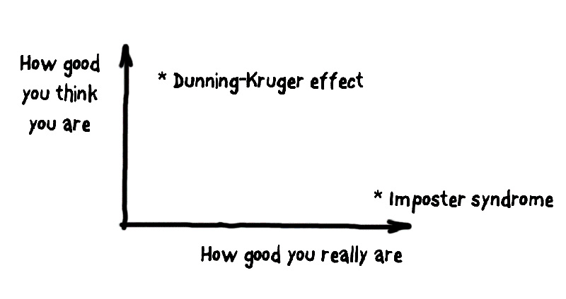
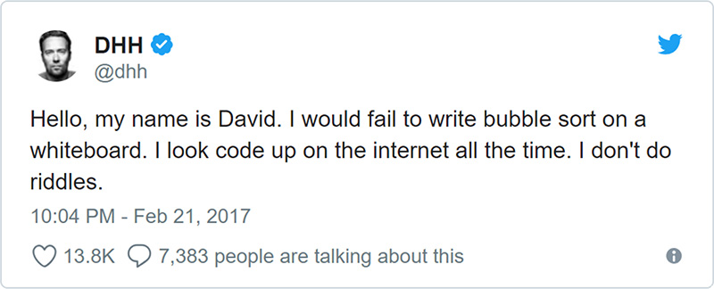
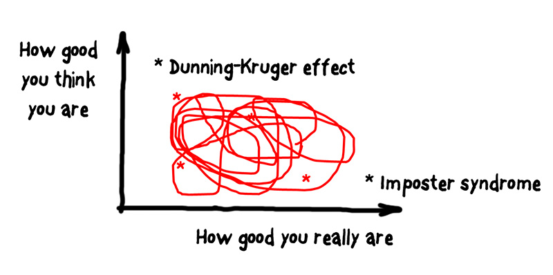
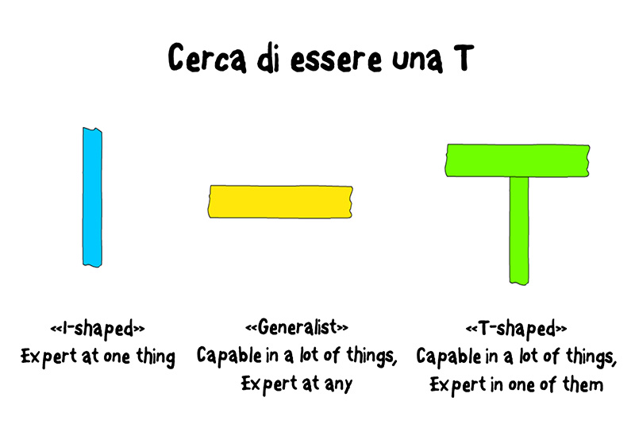
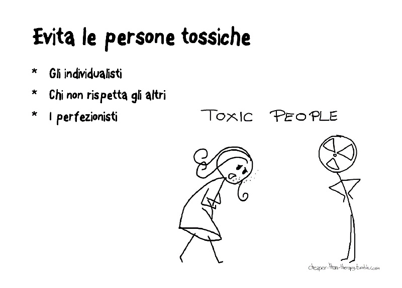

*First published in Italian on [MokaByte](https://mokabyte.it/2018/11/17/sviluppatoremediocre/) on 17 November 2018. Republished here with minimal corrections: typos, references to notes that no longer resolve, and a few stable links in place of the original ones.*

## Mediocre, who?

I already know what you are asking: why this title? Simple. Because this is what I often catch myself thinking, even though over time I have learned to handle the condition a little better. And I wrote this article precisely to share what I found out.

I have been in **software development** for twenty years. I have worked with a **multitude** of **technologies** and **programming languages**, in different companies, heterogeneous contexts and different projects.

At this point in my life I should consider myself a solid professional, one of those *seniors* you can count on when things get complicated. Even though my business card confirms that version, I think I have far more doubts today than twenty years ago.

To try to understand my true nature as a developer, I decided to face the audience of the **Italian Agile Days 2018** with a session where I said my reflections out loud and got confirmation or rebuttal from people who, like me, do this job. For anyone interested, the videos of the talks will be published on the IAD website in the coming weeks.

### One talk, one article

This article is therefore a reworking of that talk. What I said there, and what I will write here, comes from my **personal** **experience** and from the **opinions** I have formed over the years. I expect that at times you will **not** **agree**, that you will be bored or even annoyed by my words, but that is fine: what matters to me is to spark the conversation and check whether what I found also holds in someone else's experience. So please send me an email, a tweet or any other feedback you feel like sharing, and tell me your point of view.

There are two questions I have been thinking about for a long time: my **mediocrity**, real or presumed, and my relationship with the people I compare myself to at work or out of passion, especially "**the good ones**".

## What I mean by mediocrity

Let us be clear: in twenty years I did learn a thing or two… and if you meet a friend or a colleague of mine, they may even tell you I am one of "those who know their stuff". I do not consider myself clueless: I am certainly no genius, but I know I have qualities.

And yet, when it comes to **purely** **technical** **skills**, I am often struggling, and a general sense of inadequacy often gets the better of me. What is happening to me?

Simple: I constantly **forget** the most basic things, like the **options** of **Linux** commands or of **Git**, a subject I am even supposed to be an expert in… Not a day goes by without me turning to **StackOverflow** for answers to simple programming problems, such as how to read a file in Java.

Every time I read Twitter, or one of the countless sources I get information from, I see people building **microservices** in **Go**, doing **hot deployments** in **Docker** containers on **Kubernetes** clusters, while I… cannot even remember how to read a file in Java, as I said.

There is a lot of stuff I do not know, and very often I feel I am moving backwards rather than forwards in what I know.

### Learning to work

And yet there was a time when I even thought I was good: people gave me problems to solve, ideas to build… and I, in my own time and my own way, delivered them.

As a fresh graduate I had the chance to start working straight away as a technical-practical teacher, in the same school that had just let me go. In the morning I wore the teacher's clothes, while for the rest of the day, and often at night too, I worked as a "jack of all trades": from cleaning the mouse balls of the lab PCs, to setting up networks and servers, to building websites… DevOps *ante litteram*!

The school was one of those state-recognised private schools, whose headmaster could choose his staff more freely than in a public school. Moreover, in 1998 no official ranking lists existed yet for this kind of role, and that is how I started this adventure even though my only merit was having earned, as a student, the headmaster's esteem and trust.

In those seven years I learned from scratch, and on my own, how to build a website, and within two or three years I had built a platform that let parents see their children's marks and absences, and students see the topics covered and the homework assigned when they were away. I designed and ran courses for the European Social Fund on web development, I became a certified ECDL teacher, I built an e-learning platform approved by the Lombardy Region…

When I think about it, I did a lot of things. Then one day I realised I had to decide: teacher or programmer? Although I still very much enjoy helping people grow and learn, you know which way I went.

So I landed in a real **software house**, with real **programmers**, and there I realised how little I knew about programming…

It was a shock, a positive one in hindsight, but I went through moments of depression I still remember. Luckily my **colleagues** **helped** me enormously, and it is thanks to that first experience as a "real developer", which lasted eight years, that I actually understood what this job means.

## Dunning-Kruger effect vs. impostor syndrome

I was saying that at some point I **felt** good, but I was not at all. A few years later I discovered that this situation, this state of mind, even has a name: the **Dunning-Kruger effect**.

In short, psychology defines the Dunning-Kruger effect as the **cognitive distortion** by which people with **limited** **skills** consider themselves **paradoxically** **above** **average**. This happens because a person with little knowledge in a given field is usually equally **poor** at **judging** their own **level** of competence.

Another amusing situation, so to speak, is the one at the opposite end of the Dunning-Kruger effect: even though you are **competent**, you judge yourself **below** **average**, to the point of thinking you are **totally** **unsuited** to the role you hold. This is the so-called "**impostor syndrome**". Careful: this is not modesty or a healthy dose of humility, but a **psychological condition** that is often debilitating, and that prevents those who suffer from it even from enjoying the positive results they achieve and from internalising their actual successes, because they are unable to give themselves credit for them. In practice, even when your results are real and established, you perceive yourself as if you were fooling the people who recognise them…

These two kinds of experience can be represented on a chart (figure 1).

*Figure 1 – Dunning-Kruger effect and impostor syndrome as axes of a Cartesian plane.*

What caused these two conditions in me? And, above all, who is behind them?

## The good ones

Thinking about these topics, I realised that the conditions described above have almost always been generated by the **comparison** I more or less consciously keep making between myself and the people I consider capable, whom I will call "**the good ones**". Over time I have learned to distinguish two **families**, a few **genera** and several **species**.

There are "**the truly good ones**", who split into those who are intelligent and prepared but above all **generous**, and those who are more dangerous than a pufferfish: brilliant, but individualistic, impatient and often toxic for a team.

The other family is the one of the "**good***", the "good with an asterisk" or "good, but only because…": people who are not necessarily gifted with superior intellect or with vast technical knowledge, but who simply find themselves in a favourable position, often earned over time. I am talking about those who have been in the same company, or project, or "niche", for decades; those who have built a reputation as the saviour of the fatherland; those who work 7/24; or those who received a title and exercise power, most of the time undeservedly.

### Facing mediocrity

Now that I have described what I mean by "mediocrity" and introduced the people who create this condition so familiar to me, it is time to reveal how I am dealing with this trial. Let us go point by point.

## Point 1. Sometimes you really are mediocre, sometimes you are not: learn to tell the difference

One day a message from DHH appears on Twitter, someone Ruby developers will certainly know:

*Figure 2 – David Heinemeier Hansson openly admits weaknesses you would not expect.*

Something clicked. What? A developer of his calibre, someone who wrote a framework used by millions of programmers, a successful entrepreneur, admits he has gaps I would never have expected? Am I perhaps making more problems for myself than necessary?

When I read that tweet, some ideas that had been buzzing in my head for a while started to crystallise. What I believed were shortcomings of incompetent developers had suddenly become something that also characterises the **best** **professionals**, or at least those who are the best in my head.

The one about **sorting** **algorithms** and **code** **written** on a **whiteboard** is a **classic** in our field; it is often one of the obstacles between a candidate and their hiring at the court of some "big company", even though for a while now this way of selecting members of a development team has been widely criticised.

### The 4 categories of knowledge

Let us get serious, even though it will be hard after the video I just mentioned… Once we accept that **knowledge** **gaps** are not necessarily an obstacle to success, it is useful to reason about what I have simply called the **4 categories of knowledge**:

- things I know I know, or *known knowns*;
- things I know I do not know, or *known unknowns*;
- things I do not know I know, *unknown knowns*;
- things I do not know I do not know, *unknown unknowns*.

Some examples:

- I have had a driving licence for twenty years, and I can drive a car (**things I know I know**);
- I am not a cardiac surgeon and I could not perform open-heart surgery to replace the mitral valve (**things I know I do not know**);
- I have practised martial arts since I was a child, but I had never skied; yet on my first attempts on a very easy slope I never fell and managed a few short runs (**things I do not know I know**);
- for obvious reasons… I cannot give you an example of **the things I do not know I do not know**… 😊

Reflecting on this way of **cataloguing** knowledge lets us understand when we are victims of the **Dunning-Kruger** effect (*unknown unknowns*) and when the terror of being impostors creeps into our brain (*unknown knowns*).

The interesting thing I discovered is that I keep moving through this space, going from one extreme to the other. Sometimes I believe I know everything about something, then I realise I had only scratched the surface; now and then I realise I am capable of solving problems I did not think I was qualified for, and other times success disproves me when I find myself having to improvise my way out of a situation I considered too complex for my abilities.

If we go back to the earlier chart, the pattern is the one in figure 3.

*Figure 3 – A film as long as a life, starring the endless conflict between the fake impostor and the genuine charlatan.*

There is nothing to be done; the movement is perpetual: the only possible thing is to **check** your position at **regular** **intervals**, using a few small tricks.

### Choose carefully how to invest your resources

One of the first things I learned the hard way is that **you** **cannot** **learn** **everything**. Something new comes out every day, and **JavaScript** developers will understand me even better than others, and keeping up with all of it is impossible. Of course, curling up into a shell and ignoring a changing world is the **worst** **strategy** for a knowledge worker like a programmer, but knowing what to store in your brain is essential.

Over time I have learned to **select** the things with the highest **"strategic"** **value**: that is why I prefer spending my time reading about **Domain Driven Design** rather than **SpringBoot**, for example. A simple mantra to repeat could be "Learn what you cannot easily search for on the internet": remembering all the options of **JUnit** is good, but knowing how to approach a ten-year-old **legacy** **codebase** through tests… is better.

I try to learn the **fundamental** **concepts**, to know **technologies** just **enough** to come back to them if I have a problem they can solve. I try to keep the load on my shoulders light, knowing that out there I have an endless library to draw information from: what matters is **knowing** **what** **to** **search** **for**.

### T-shaped people

This way of seeing life, professional and otherwise, has been around for a few years, and it has forcefully entered the mindset of agilists: "T-shaped" skills. But what does it mean?

*Figure 4 – Hyper-specialists ("vertical" skills), generalists ("horizontal" skills), balanced professionals (the "T" shape).*

Figure 4 helps explain the metaphor. The first case is that of "vertical" skills, being an "**I**": a person who is super-expert in a technology or in a particular branch can excel as long as the branch stays alive; but when it breaks, and we know how fast the life cycle of technologies is, the risk is to be left stranded, or worse, without a job.

Knowing a bit of everything, but nothing really well, is just as counterproductive: it is the case of the "horizontal" skills represented in the image by the "**—**". There are skills you cannot do without, and fields that require seasoned professionals. Not having a command of "the fundamentals", for example HTTP, HTML, JS and CSS for someone who wants to position themselves in frontend, makes the climb to success steep.

The right compromise is to be balanced: what a discovery! Knowing various topics acceptably, so that you can get by in a series of common situations, and then having a few fields of choice is the best way to do this job, as well as the winning weapon for those looking for their first job or wanting to turn their career around.

This concept can also be applied at a higher level than mere technological skills; being a "**T**"-shaped programmer, and having improvisational theatre or scouting among your out-of-work activities, can for example be the extra resource for solving professional questions that have nothing to do with code, but which are often also the most critical ones…

## Point 2. Do not feel mediocre next to the good*

Coming back to the "good with an asterisk", I have learned not to feel mediocre any more even in the face of obvious inferiority, when that inferiority is only the result of a position of advantage. It is a bit like running the 100 metres against someone who has a 50 or 60 metre head start: I will certainly lose, but that does not mean I am objectively slower.

These people are often victims themselves of biases and situations that somehow forced them to become what they are. And, despite everything, they are precious resources for those who have just joined the company or the team, as guardians of **tacit** **knowledge**.

After first mythologising them and then demonising them, now that I have learned to recognise them, my first approach is to help them: first, by trying to make them aware of the situation and of the role they play, and second, by easing their "detox" from all those ways of behaving that do no good either to them, or to the team and the company they work for.

### Typical behaviours

Among them we find the "**silos**", those who hold the **knowledge** of a **domain**, of a **codebase** or of any **resource** in the company. In this case you need to work on emptying them, making information flow more easily.

It is not rare to meet hostility, more or less conscious: when you perceive the will to keep the status quo, you may find yourself facing the "guardians", those who strenuously preserve their "castle" of knowledge. In this case conflicts are frequent and, short of a "Franciscan conversion", you need to ask for help from whoever leads the company: these people are in fact a time bomb.

"What happens if Tizio leaves? He wrote the program 17 years ago, and only he knows how to touch it… If he leaves, we shut up shop…". This could be the speech bubble over the head of an administrator who at some point finds himself hostage to his own employees; work to highlight dangerous situations, and fight so that the issues are faced.

Then there are the "**heroes**", those who say "I'll fix the bug, it's too complicated for you because you don't know that…". These people usually have a big heart, but sooner or later they give in too, to put it mildly. The more critical the issue, the more the collaboration of every team member is needed; if the codebase is ugly, dirty and mean, if the application is an endless source of support tickets, one way to tame the fire, besides writing better applications… is to make **everyone** **aware** of **weak** **points**, **oddities** and **flaws**, so that anyone can fix them when needed.

And do not believe that working 12 hours a day is the solution: here I am blunt: **working more than you should is the same as cheating**.

It is as if, at 90 minutes, after the final whistle, someone stayed on the pitch with the ball to score one more goal and overturn the result. Solving problems is satisfying, and maybe looking good in someone's eyes, but it is unfair to those who perhaps have family commitments, or any perfectly normal private life, and who therefore cannot do the same and earn the laurels.

Then there are the "**outlaw cowboys**", those who claim the right to do everything as they see fit, with very few concessions. Seniority, and perhaps a more or less obvious competence in a field or on a project, leads them to adopt behaviours that are harmful to a team and must be eradicated. Even if effective in the short term, they are often a natural disaster ready to raze even the best team to the ground.

Finally I frequently identify, often in large companies, people who, armed with a title awarded more or less deservedly, place themselves above the team, thinking they can impose solutions and strategies without even needing to discuss them. They are the analysts, the **team** **leaders**, the solution architects, or all those figures who say what to do but then do little or nothing in practice…

Let us be clear: there are those who hold this position for one reason or another and are no problem at all; I am thinking of all those developers with vast experience who earned their title, and who, rather than imposing solutions, help the team discover "the best technologies and architectures" to deliver the company's next success.

I am talking instead, for example, about those figures imposed by clients who then rely on external suppliers, and who believe this way they hold the reins of a project. Maybe it worked sometimes, but to this day I have never had the pleasure of witnessing a dazzling success case.

After showing you some of the people I have met over the years, I want to end with some heartfelt advice.

If the situations created by these people are not perceived and faced; if, for whoever leads the company, they are not a problem at all, indeed "thank goodness Tizio is here to solve our problems!", then think about it carefully: maybe it is time to change company.

## Point 3. Beware of "10x developers"

If you spend time on LinkedIn, you will surely have come across job offers for "**guru**", "**ninja**" or "**rockstar**" **developers**. Unless by "**rockstar developer**" you mean someone who knows the [Rockstar](https://github.com/RockstarLang/rockstar) language, I personally steer clear of anyone looking for, or considering themselves, a developer with superpowers.

*Figure 5 – Beware of "toxic" individuals.*

Because these people, often **truly good**, tend to be **terrible** **collaborators**. It is the classic case of the sociopathic genius, of those who end up insulting anyone unable to keep up with them; such an individual, however talented, must be avoided: they are a corrosive presence, and the team would end up dissolving. Since nowadays it is rare to do this job without, at some point, working with other people, I consider it highly risky to give in to the temptation of hiring the super-expert of the moment, if they have no will to collaborate and maybe even help colleagues improve.

## Point 4. When you meet the truly good ones, do not let them go!

*Dulcis in fundo*, I want to close this article by paying tribute to the people who have made me, and keep making me, a better programmer. I am talking about colleagues and friends who, besides having talent, intellect and qualities of every kind, are willing to **share** them to help you grow.

I am not talking about "nursemaids", but about people able to wear the "right hat" for the occasion, whether that of the **instructor**, the **coach** or the **mentor**. When I meet this kind of person, my attitude is by now established: I try as much as possible to work with them, to ask them all the questions that come to mind to clear up doubts, to compare notes without fear of looking bad. Unlike with the "10x", here nobody judges you.

I am reminded of an anecdote told by Piergiorgio Odifreddi in one of his podcasts, which I highly recommend. In one episode, the well-known science communicator talks about the exceptional gifts that characterised [John Von Neumann](https://en.wikipedia.org/wiki/John_von_Neumann). Famous for his "computational abilities", his colleagues in physics and mathematics used to turn to him when they thought they had a brilliant idea to develop or an irrefutable thesis; often, within minutes, Von Neumann was able to find flaws in the reasoning, invalidating studies that had lasted weeks. And among the people seeking advice there were Nobel laureates, not second-year students!

This anecdote stuck with me because this is the attitude I have pursued for a long time: when you think you have a good idea for a new feature, or when you are trying to understand how to fix a bug that is tormenting you, look for your Von Neumann and compare notes. I have never left that kind of conversation thinking I had wasted my time; on the contrary, I find comparing notes with the best to be one of the privileged roads to personal growth.

## Conclusions

In this article I have tried to tell experiences and "lessons learned", without ever losing sight of the fact that this is what I have lived and systematised myself: I do not claim in any way to dictate universal rules, but I would be pleased if at least some of my reflections could serve as a starting point for some developer's personal journey.

As you will have understood, however, although study and practice certainly require personal effort, this profession must free itself from an individualistic approach. That is why I want to take my leave with this thought: "Be the worst player on the best team that will let you play."
