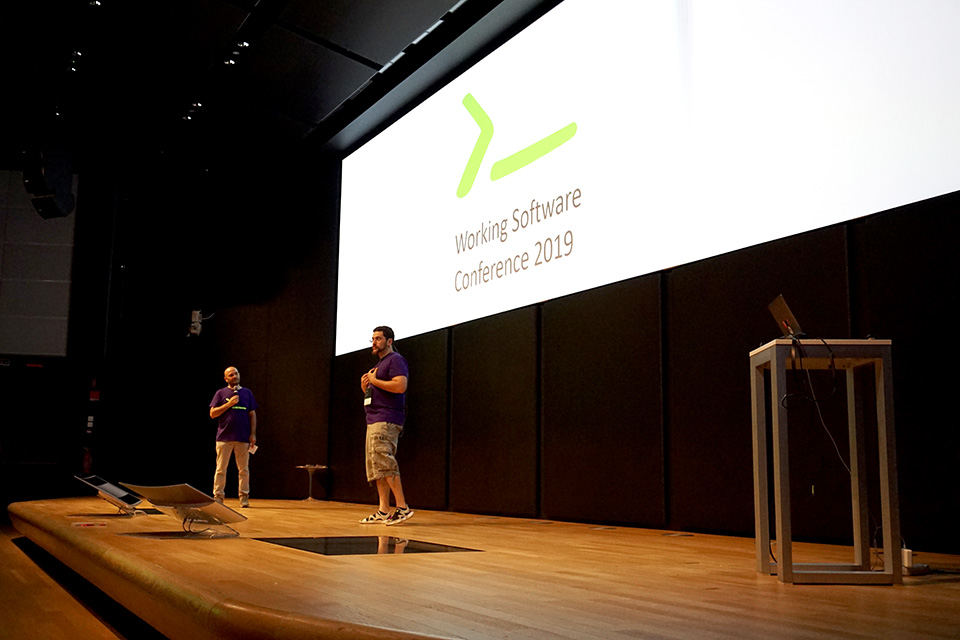
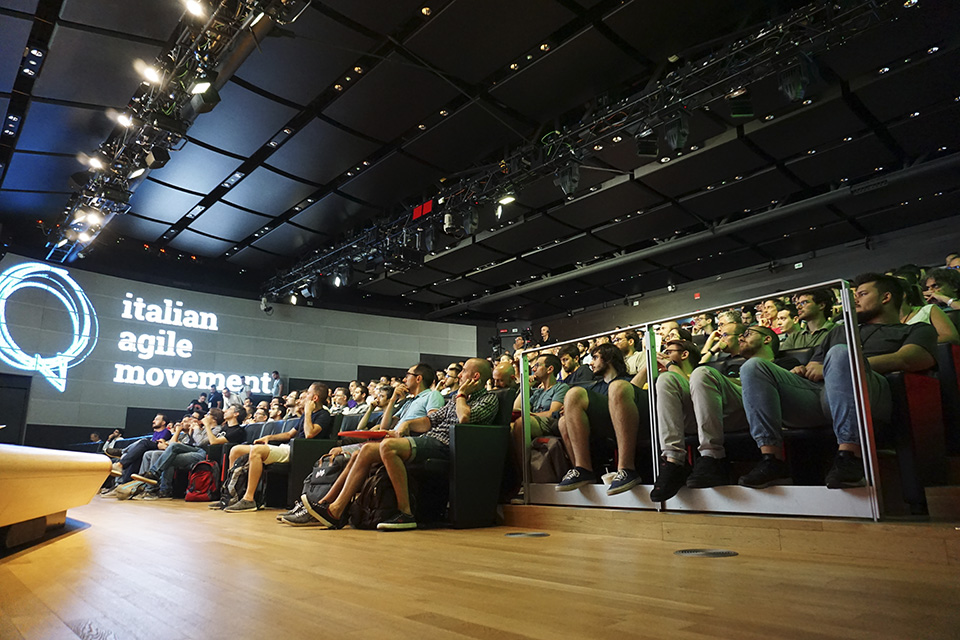
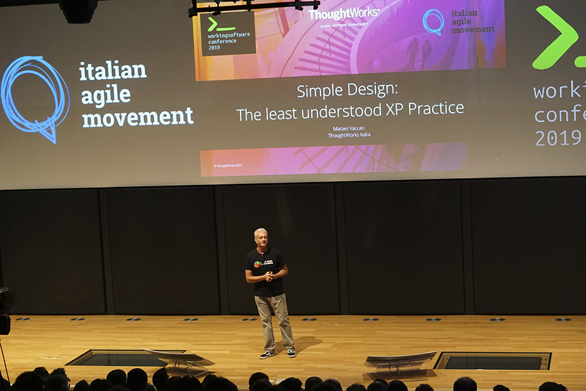
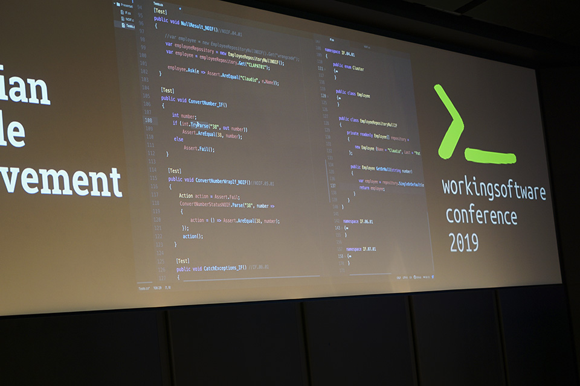
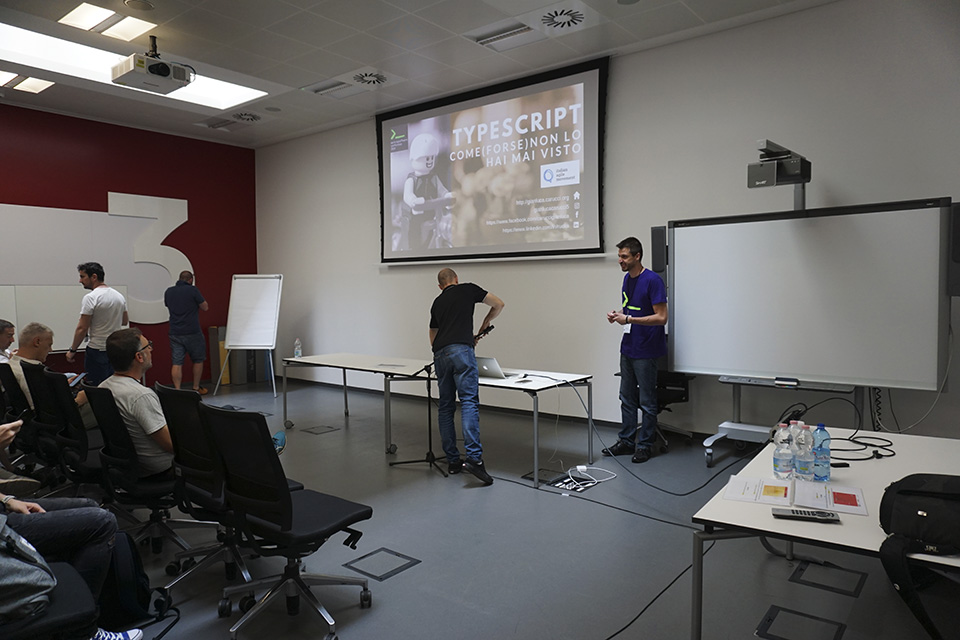
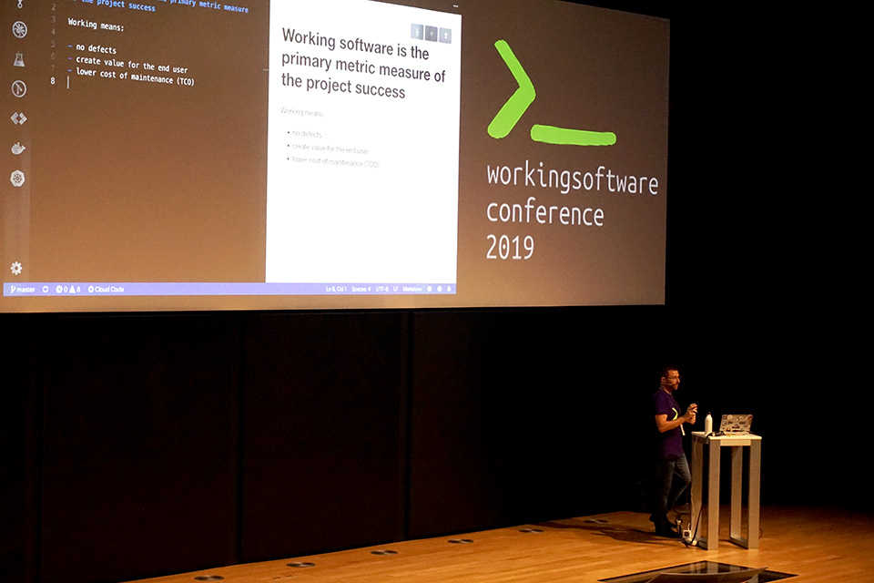

*First published in Italian on [MokaByte](https://mokabyte.it/2019/07/20/workingsoftwareconf19/) on 20 July 2019. The text is what I wrote back then, with typos fixed.*

## Yet another conference?

Following what people usually do these days, let us start by covering ourselves… *Disclaimer*: the author took part in the organisation and preparation of the conference, but did not propose any content. I will therefore tell my impressions as an *embedded* observer, trying to be as objective as possible and not hiding a few small problems that can certainly be improved.

But, having made this dutiful statement of **transparency**, I want to begin this article by explaining why we went and made our lives even more complicated… by organising another conference, as if there were not enough already.

### What Working Software Conference is

**Working Software** is a free one-day conference, part of the **events** promoted by the Italian Agile Movement. It took place last 3 July at the Vodafone Theatre in the Lorenteggio district of Milan, a remarkable venue for its spaces and the kind of rooms it offers.

### Why Working Software

A look at the current state of Agility, especially in Italy, convinced us that organising another conference could be a good idea, given the **peculiar angle** we wanted to give the event. What we were doing, in fact, was filling a gap that had opened over the last few years, which saw a significant spread of "agile" topics inside companies, but often with attention almost exclusively on the important organisational and group-dynamics side, and on corporate transformation processes.

So, in a landscape where **agile** **principles** and **practices** are spreading more and more into "non-software" contexts, the Working Software conference would be a reference point for those situations where "[**Working software** is the primary measure of progress](https://agilemanifesto.org/principles.html)" still holds.

There was a strong desire to bring **programmers** back to IAM conferences such as the Italian Agile Days: we had noticed that those events were no longer attended by many of the **developers** who joined the **Agile Manifesto** from the start, but who then did not follow the shift towards agile coaching and agile management and kept mostly **programming**.

*Figure 1 – This new conference has a precise target: programmers who adopt agile principles and want to keep developing software.*

These people often work in contexts that are agile in practice without the adoption of a real, structured methodology: continuous delivery of value to the customer, working products, iterative and incremental development cycles with short and precise deadlines for new *releases*, small self-organising teams focused on results.

These people, who are certainly not few, remain primarily interested in **software** **development** and **technical** **practices**, which in recent years have often been pushed into the background at the many "agile conferences" held regularly. And in that sense, **Working Software** wanted to address them first of all.

## How it went

Clearly the need to be filled was not just our imagination, but matched a real "gap" in the landscape of agile conferences in our country. In the end we had 433 registrations and the number of people who actually attended went above 300, with a *drop rate* in line with free events of this kind.

*Figure 2 – A remarkable audience and a suitable venue marked this first edition of the Working Software conference.*

Let us add that 72 proposals were submitted between **talks** and **workshops**, and it was hard to choose only the 18+6 that were accepted.

### Talks and workshops

The Working Software conference opened with the keynote, in which Matteo Vaccari went through the **technical practices** of **eXtreme Programming**, focusing in particular on **Simple Design** and explaining what "simple" means in this context.

*Figure 3 – The opening keynote, given by Matteo Vaccari.*

After that, the programme ran on six parallel "tracks": three tracks for "frontal" talks and three tracks for workshops, with different sessions in the morning and in the afternoon, for a total of 6 workshops.

As for the talks, it must be said right away that many presentations offered moments of **live coding**, in the very spirit of the conference, which aimed where possible at a **practical angle**, with few slides and a lot of code.

*Figure 4 – The live coding format dominated.*

### Possible improvements

There were also a few **problems**, for instance technical ones, with difficulties in the connections to the projectors in the track rooms. And there are considerations to make about the intention to **internationalise** a conference like this: on one hand, we tried to make sure every talk track had at least one session in **English**; on the other, we noticed that the attendance of foreign developers was minimal anyway, and we will have to assess whether this is really the way to go, given the **Italian specificity** of the Italian Agile Movement.

Another area to work on is that of **workshops**: we know how important they are, to the point that at some conferences they become the focal point of the whole event. But in this case we were struck by the fact that several participants, who had initially signed up for a workshop, then preferred to take part in the various talks. Maybe they preferred the variety of different presentations over the single-topic depth of a workshop, but in practice this gave us material for reflection and for trying to improve in this area too.

### Final raffle

Besides the various coffee breaks, which then become occasions to network, talk and exchange contacts, before the actual conclusion we organised a **final raffle** with prizes, some of them of considerable value, provided by the sponsors: it was a fun and unusual way to highlight the fundamental contribution of the sponsors while avoiding the classic litany of acknowledgements. Concretely, about thirty prizes were drawn and went to various lucky participants.

## The themes: languages, tools, practices

As said, the **Working Software conference** was dedicated to technical excellence, software development in the Agile context, good development practices, languages and architectures.

Despite the variety of proposals, some topics came back several times in talks and workshops, showing that some themes are particularly felt and current. Of course, in giving a short account of some sessions we only cover those we could attend, with no criterion of preference: all the speakers would deserve a mention, obviously.

### Languages

As for **languages**, there were some topics that drew most of the attention, and among them is certainly that of programming languages oriented towards **distributed systems**.

Gianluca Padovani gave a talk titled *DDD loves Actor Model and Actor Model loves Elixir*, from which the power and effectiveness of a language like [**Elixir**](https://elixir-lang.org/) emerged for writing software suited to DDD, CQRS and ES scenarios, thanks to the Actor Model built into its Virtual Machine.

**Elixir** came back in Nicola Fiorillo's talk too, titled *Nella mente di un alchimista*: here too the aim was to illustrate the differences, including **conceptual** ones, between Elixir and the more classic programming paradigms.

Other languages caught the speakers' attention, and among them are certainly [**Kotlin**](https://kotlinlang.org/) and [**TypeScript**](https://www.typescriptlang.org/).

*Figure 5 – TypeScript was one of the languages discussed.*

Dario Coletto talked about *Kotlin Multiplatform: The real "write once, run anywhere"*, a project to make it possible to write **truly cross-platform** code in Kotlin, which is then compiled for the different systems (Android, iOS, web, native Windows/Linux/Mac OS and so on).

In *TypeScript come (forse) non lo avete mai visto*, Gianluca Carucci gave an overview with code examples of the TypeScript language, highlighting in particular the **shift** from the **OOP** paradigm to a **functional** language that it allows.

### Tools

Alongside the theme of languages, the "tools" component also raised some interest: which **tools**, which **environments**, which tool chains can make the developer's job easier and allow a reduction of waste and a consequent improvement in software quality? What real novelties are on the horizon?

An overview of the **tools** that can be used to assess **code quality** was the subject of Thomas Rossetto's talk titled *QCT fantastici e dove trovarli*: which Quality Check Tools proved valuable in concrete experience? How does the chosen tool chain fit into a Continuous Integration context?

In *Quarkus 101: First (blazing fast) steps*, Giuseppe Bonocore introduced the new Java stack for microservices made by Red Hat, [**Quarkus**](https://quarkus.io/). It was a demo with live coding that highlighted the truly remarkable **performance** of Quarkus: a "relaunch" for **Java** code that with this tool reaches performance unthinkable until recently.

### Practices

Clearly, knowledge of languages and use of tools must turn into software development **practices**, and several sessions focused on **tests**, **code reviews** or a series of good practices derived from experience.

Stefano Magni, for example, in *Mastering UI testing* focused on writing **tests** for **web user interfaces**. Proper use of tools like [Cypress](https://www.cypress.io/) and a Test Driven Development approach to UIs help write and maintain your test suite for interfaces effectively, reducing errors and improving the flow of the production process.

*7 buone abitudini per scrivere software funzionante* was instead the talk in which Giulio Roggero, drawing on his experience, proposed a series of **good practices** for writing quality code, showing certain concepts live through live coding examples.

*Figure 6 – A live overview of good practices for writing quality code was presented by Giulio Roggero.*

For software to be truly **working software**, it is not enough that a set of lines of code works somehow: the code must be easy to maintain, able to "self-repair", automation must be there from the start, and we must accept that design is never final (**evolutionary design**). You need to know the technology well, but also to build good habits to make the best use of the technology you know.

This quick summary of some proposals was only meant to be "demonstrative": other participants will certainly have attended other presentations, or workshops, and will have been particularly struck by different proposals.

## Developing

As good developers… now it is time to develop. On one hand there is the satisfaction of having helped create an event able to catch the interest and needs of many: we had confirmation from the presence of "early days" agilists who, in recent years, were no longer seen at conferences more oriented towards the adoption of agility in business and managerial contexts. And in terms of absolute attendance too, we can call ourselves satisfied.

On the other hand, for a next edition, we will have to carefully assess the balance between talks and workshops, trying to involve even more people from the call for speakers and the early organisation phase.
